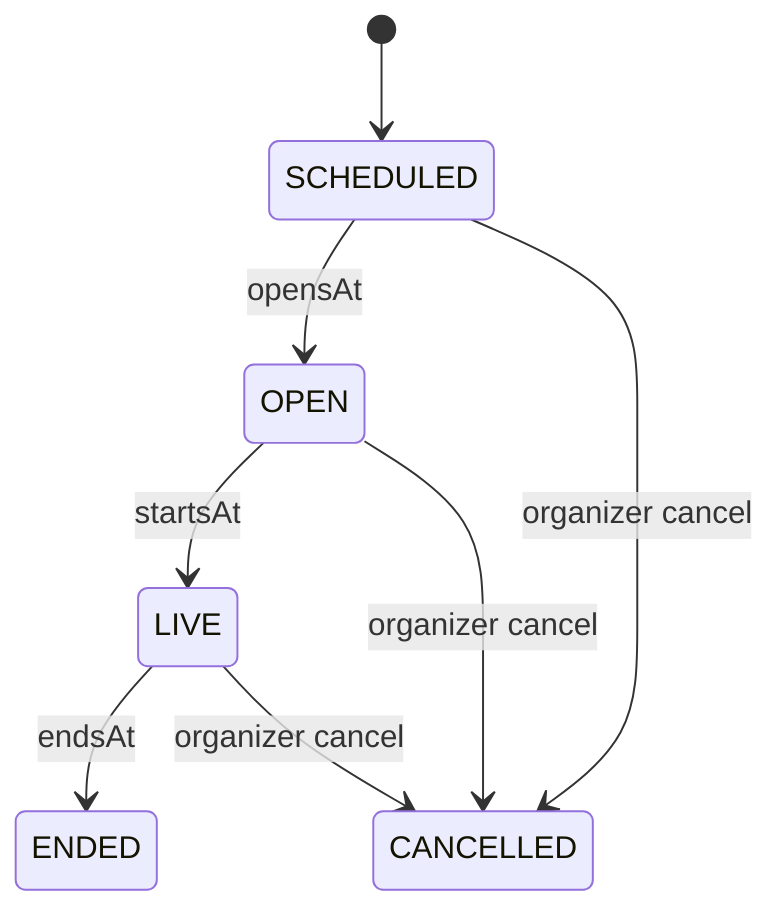
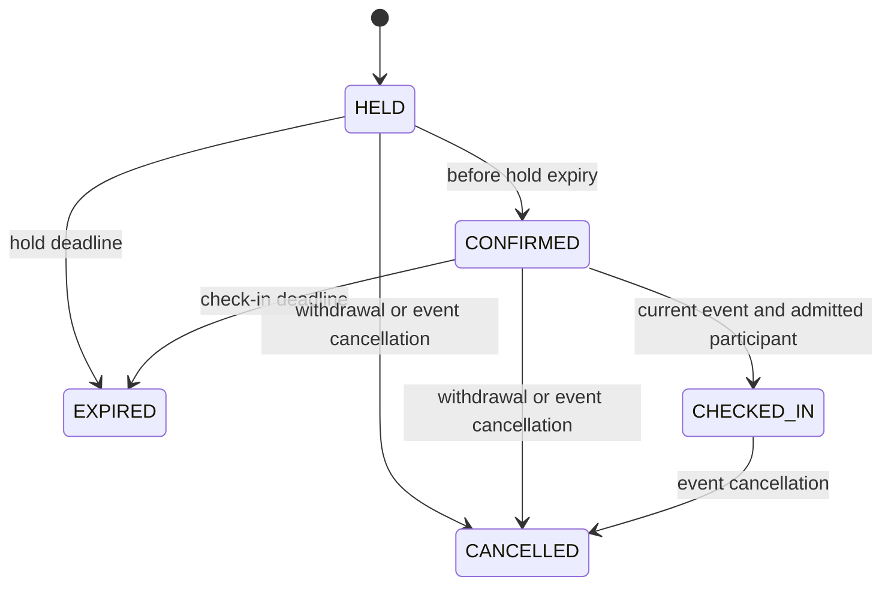

# Events and reservations

M12-01 implements strict time/capacity contracts and pure server lifecycle models. Existing registry events capability was audited; there was no pre-existing schedule/RSVP/reservation runtime to replace. Dependencies M04/M05/M06/M08 are locally verified. No HTTP endpoint, migration, event UI or runtime booking exists in this slice.

Observation may skip phases after a pause/restart. At endsAt natural end wins over late cancellation. Terminal states cannot reopen. Schedule inputs are UTC instants with millisecond precision plus explicit IANA timezone/UTC; no offsetless local times. Opens <= starts < check-in-close <= end, at most24hours. Intl displays endpoint offsets independently, including DST changes. No recurrence/local-wall-time inference. Persistence must check PostgreSQL zone availability too.

Hold deadline is min(createdAt + server1..300seconds, startsAt). Confirmation cannot extend it. Check-in requires confirmed state and [opensAt,checkInClosesAt); the model grants no room/seat authority. Exact deadline expiry wins over participant commands. Natural event end expires outstanding reservations and retains historical attendance. Clock rollback rejects transitions; strict persisted-state validation rejects inconsistent deadlines.

Capacity policy has1..100places, bounded whole-party size, zero overbooking and explicit disabled/FIFO waitlist. Held/confirmed/checked-in parties consume places until release; future SQL must lock the same event/resource before expiring/counting/allocating and enforce participant uniqueness. Model arithmetic alone proves no concurrent allocator behavior. Waitlist cannot force attendance. Table overlaps/TTL/check-in are M12-03; actual race/DST integration is M12-06.

M12-02 will add policy-gated durable schedules/catalog/RSVP and explicit opt-in calendar export. M12-04 owns organizer/performer/mod permissions, audience approval and durable cancellation notices. M12-05 owns filtered discovery/invitations. Current identity/registry/safety/block policies must guard every runtime action; private/dating event data must not leak in public catalogs. No real addresses, payments, media rights or public event activation. All real flags remain OFF. See ADR0034 and m12-model-checks.json.
