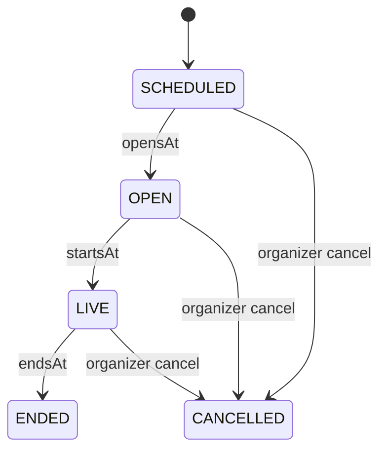
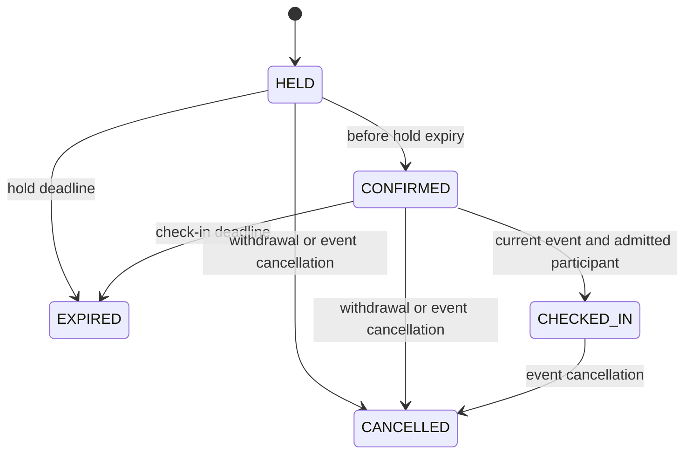

# Events and reservations

Restaurant integration adds reservation-owned voluntary parties and dinner offers (M18-02/05;ADR0056/0059). A holder explicitly chooses room-public or invite-only party disclosure. Invite-only viewing/joining requires a current accepted friend offer and recipient invitation opt-in;acceptance does not allocate attendance,room,chair or RSVP. The listed slot remains public. Each diner must independently enter the actual room and join. Audience changes,block/unfriend,opt-out,closure and independent Stop withdraw existing consent. Private party identifiers/counts/rosters never enter event discovery or uninvited party views.

`GET /v1/reservations/dinner-invitations` returns at most20 own receipts with currently permitted metadata or null;`POST /:id/party/invitations` belongs to the actual checked-in holder,not the schedule organizer. Dinner respond/block routes require own-contact proof,Origin/CSRF and durable keys. Pending120second TTL and accepted check-in-close access are separate. Current host visit/session/safety and world disclosure are rechecked;historical receipts grant no authority. Native inbox snapshots expire after30seconds,party counts after5seconds. Migration0029 owns visibility/offers/receipts;parent90day retention/account erasure cascades. See [Restaurant scope](RESTAURANT.md) and m18-private-checks.json for verification and limits. Older sections below describe their original task boundaries.

## Discovery and private invitations — M12-05

GET `/v1/events` may omit worldSlug to discover up to50 upcoming listed events across eligible available public worlds. Each row repeats current block/safety/version checks; private sessions, hidden/restricted worlds and dating never enter this catalog. Accepted private invitations do not make an event public.

POST `/v1/events/:id/invitations` is original-organizer-only, requires current friendship/recipient opt-in and strict schemaVersion/recipientId with Origin/CSRF/key. Offers expire within120seconds clipped at start. GET `/v1/event-invitations` privately previews active offered title/world/schedule; no roster/contact IDs. POST `/v1/event-invitations/:id/respond` accepts/declines/withdraws. Acceptance permits private-event access until its end, continuously gated by current consent/world/safety, and allocates no RSVP/table/room. Terminal offers disclose no updated event metadata.

Block/unfriend/opt-out transactionally revoke accepted access and private participation. Callback failure rolls all effects back. Re-enabled settings/friendship and old retry keys cannot resurrect grants. Event cancellation includes invited recipients in private cancellation notices. Version-only postcommit socket hints reveal no event details. Mutation receipts, quotas, bounded inbox/export, erasure and90day event-retention cascades apply; migration0022/ADR0038 document scope and rollback. No event UI, adult access or public rollout is enabled.

## Scoped controls and private cancellation — M12-04

Default organizer/performer grants are persisted, registered-account-only, scoped and expiring; migrations provision nobody and no self-grant endpoint exists. POST events now exposes guarded scheduling to authorized organizers. POST events/:id/adjust requires the original organizer, expectedVersion and an unoccupied SCHEDULED event; time/zone/slot checks repeat. After participation, cancel and create a new schedule. Control version tracks adjust/cancel.

GET events/:id/controls returns own capability hints. Performer-ready is voluntary metadata in OPEN/LIVE, with no stage/media/chat/moderation power. Block/end/cancel clears it; existing own readiness can be withdrawn after role/world closure. Existing M08 registered/scoped moderator grants are independent and may cancel covered events even during world disable/incident closure.

Cancellation atomically changes state/version, releases RSVP/table/waitlist allocations, clears readiness, stores unique participant notices and a mutation receipt. Sorted recipient-account locks precede event rows; changed recipient snapshot requests an original-key retry instead of missing notice/lock inversion. Failures roll back all effects. Durable private GET events/notices is bounded100; connected recipients receive only schemaVersion refresh hints after commit. Inbox/export/erasure and event90day cascades apply; no delivery/read/email/calendar-recall guarantee. Interactive audience remains schema/SQL denied; independent moderator approval and actual stage coverage remain a mandatory M19 gate. No real staff, public flag or new event UI. See ADR0037 and EVENT-OPERATIONS.md.

M12-01 implements strict time/capacity contracts and pure server lifecycle models. M12-02 adds durable silent schedules, private catalog/RSVP and opt-in calendar API; M12-03 adds virtual table holds/check-in/FIFO; M12-04 adds scoped controls/private cancel notices below. Existing registry events capability was audited; there was no pre-existing schedule/RSVP/reservation runtime to replace. Dependencies M04/M05/M06/M08 are locally verified. No event UI or actual Restaurant adapter is claimed yet.

Observation may skip phases after a pause/restart. At endsAt natural end wins over late cancellation. Terminal states cannot reopen. Schedule inputs are UTC instants with millisecond precision plus explicit IANA timezone/UTC; no offsetless local times. Opens <= starts < check-in-close <= end, at most24hours. Intl displays endpoint offsets independently, including DST changes. No recurrence/local-wall-time inference. Persistence must check PostgreSQL zone availability too.

Hold deadline is min(createdAt + server1..300seconds, startsAt). Confirmation cannot extend it. Check-in requires confirmed state and [opensAt,checkInClosesAt); the model grants no room/seat authority. Exact deadline expiry wins over participant commands. Natural event end expires outstanding reservations and retains historical attendance. Clock rollback rejects transitions; strict persisted-state validation rejects inconsistent deadlines.

Capacity policy has1..100places, bounded whole-party size, zero overbooking and explicit disabled/FIFO waitlist. Held/confirmed/checked-in parties consume places until release; future SQL must lock the same event/resource before expiring/counting/allocating and enforce participant uniqueness. Model arithmetic alone proves no concurrent allocator behavior. Waitlist cannot force attendance. Table overlaps/TTL/check-in are M12-03; actual race/DST integration is M12-06.

M12-04 owns organizer/performer/mod permissions, audience approval and durable cancellation notices. M12-05 owns expanded filtered discovery/invitations. Current identity/registry/safety/block policies guard runtime actions; private/dating event data must not leak in public catalogs. No real addresses, payments, media rights or public event activation. All real flags remain OFF. See ADR0034 and m12-model-checks.json.

## Durable schedules and own RSVP — M12-02

World events capability requires explicit eventPolicy version/maxCapacity <= world capacity. Trusted EventService.schedule authenticates and invokes an internal organizer port (default deny); there is no public schedule route. Only silent audience, UTC schedule and PostgreSQL-supported IANA zone are accepted. OpensAt must be future within30days, at most100 nonterminal schedules/world. No live-audience approval is inferred from permission to create a silent event.

GET `/v1/events?worldSlug=...` returns up to50 listed upcoming projections plus truncation; GET `/v1/events/:id` returns current phase and own RSVP only. Exact IANA zone and independently formatted start/end offsets are supplied. Restricted/private/hidden worlds including dating are closed in this slice. Private events are owner-only; there is no attendee list or raw organizer identity. Current registry generation/policy, shared safety and bilateral organizer blocks guard access.

POST `/v1/events/:id/rsvp|withdraw` uses schemaVersion-only body and Origin/CSRF/key. RSVP reserves one place/account before startsAt. Sorted account locks then event row lock serialize count+allocation+receipt; unique event/account prevents duplicates. At most10 active future RSVPs/account,12 new joins/hour and30 mutation receipts/minute. Exact retries observe canonical state without a second allocation. Withdrawal works outside room/disabled world and returns only own metadata. Block withdraws organizer contact in the same social transaction; failed callback rolls both back. Erasure cascades allocations without a stale capacity counter.

POST `/v1/events/:id/calendar` requires optIn:true, auth/Origin/CSRF/key and current confirmed RSVP. It returns a text/calendar attachment with escaped text,75-octet UTF-8 folding, UTC instants at second precision and IANA/offset labels. UID/creation DTSTAMP are stable; no attendee contacts/secrets/URLs. No automatic send/file/external calendar registration occurs. An RSVP never grants room membership, seat, attendance or rewards.

Migration0019 owns events/RSVPs/mutation receipts and fair recovery sequence. Relevant operations observe server boundaries; three-second maintenance processes20 active events/batch and purges up to100 terminal events older than90days, cascading receipts. Own export is bounded100 per collection and projects elapsed states. DB outages/batching delay observation; no notification SLA. Trusted adapters must respect domain-owned locks and reviewed metadata; all default real-world flags stay OFF. Rollback disables policies/adapters while preserving retained tables. Table slots/holds/check-in/waitlist are in M12-03 below; operational roles/cancel notifications remain M12-04. See ADR0035 and m12-rsvp-checks.json.

## Table slots and explicit waitlist — M12-03

Optional trusted reservation policy declares virtual resources/capacities, maxPartySize,1..300second hold TTL and disabled/FIFO waitlist. A scheduled resourceKey selects whole-table booking; missing key keeps RSVP behavior. Same-world/resource windows [opensAt,endsAt) cannot overlap under the schema/world schedule lock. Adjacent slots are allowed. Table events reject RSVP; unique active slot index and account/event SQL locks serialize full-party holds, confirmations and expiry.

POST `/v1/reservations` requires strict schemaVersion/eventId/partySize and Origin/CSRF/key. HELD deadline is clipped at startsAt; POST `/:id/confirm` never renews it. Exact old keys return the old record after expiry/replacement/restart. POST `/:id/check-in` additionally requires a strict current room source and actual connected session/membership in the world within the check-in interval. Room-owner authorization wraps the transaction and is rechecked before commit. Booking grants no room admission; full/forged/stale room rejects and preserves an unexpired confirmation. Only the authenticated holder checks in; party count does not force other users or guarantee group seats. Actual table/scene routing remains M18.

POST `/v1/reservations/waitlist` explicitly records FIFO consent for at most5minutes clipped at startsAt, max50waiting/event and5/account. No automatic offer/confirmation. First unexpired entry must explicitly create a hold with the same party size, then confirm. POST `/waitlist/:id/leave` withdraws only one's own entry; old keys cannot renew expiry. A sanctioned queue head can delay later claimants until its bounded expiry; M12-04 owns moderator queue controls.

GET own `/v1/reservations` and `/:id` are bounded/private. Own cancel and waitlist leave work after closure/block. Block atomically cancels organizer contact including bookings/waitlist; failure rolls back both. Quotas30/minute,60/hour and5future active allocations/account apply to new receipts. Own export bounds100bookings/100entries and projects elapsed states; erasure/event90day retention cascade children. No peer/organizer/session/fingerprint data is exposed. Calendar currently remains RSVP-only. No booking UI, actual Restaurant integration, public flag or automatic reward/report/sanction is introduced. Migration0020/ADR0036 and m12-reservations-checks.json record compatibility, rollback and actual verification.
