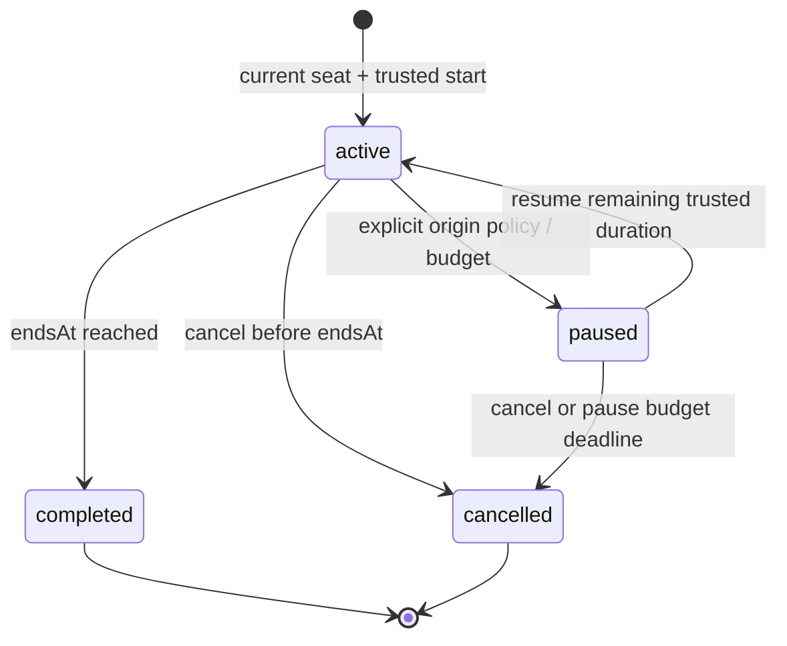

# Trusted Focus Engine

M10-01 source comparison is in FOCUS-COMPATIBILITY.md. M10-02 implements the private server lifecycle/API and03 private history. M10-04 adds the reusable focus-ui package and live browser controller in SDK Sandbox,with pause denied; synthetic integration tests additionally supply an opt-in paused-library policy. These are not integrated legacy worlds.

## API and Authority

| Endpoint | Strict v1 behavior |
| --- | --- |
| POST /v1/focus | schemaVersion1,source{epoch,roomId,membershipId},durationSeconds900/1500/3000; authenticated current seat in focus-capable world required; UUID Idempotency-Key/Origin/CSRF;201 own canonical timer |
| GET /v1/focus | Own current active/paused or latest terminal timer plus serverTime;null when none |
| GET /v1/focus/:id | Own canonical current/terminal timer; another account gets404 |
| GET /v1/focus/history | Own descending creation order; optional worldSlug,cursor(UUID),limit1..50(default20); items/serverTime/nextCursor; foreign or mismatched cursor404 |
| GET /v1/focus/summary | Own inclusive from/to ISO dates,max31days; optional IANA timeZone(default Asia/Ho_Chi_Minh)/worldSlug;zero-filled canonical completion counts/focusSeconds |
| POST /v1/focus/:id/pause,resume,finish,cancel | Body schemaVersion1 only,UUID key/Origin/CSRF; policy-gated trusted transition; no client time/completed/notes/reward field |

Results contain schemaVersion1,serverTime and nullable session with id,phase,duration,start/end/change/pause timestamps,remainingMs,canPause,pauseBudgetMs and immutable origin{worldSlug,roomId,seatId}. IDs/timestamps are canonical observations,not room access tokens. Account-scoped idempotency fingerprints bind operation/input; same key with changed input conflicts. A replay returns the original timer's current observation and cannot repeat pause/start or resurrect terminal state. One running/paused timer per account spans all sessions/tabs,even after moving worlds. New start reconciles expired prior timers before applying uniqueness.

Source authorization runs in the owner queue and an account-locked SQL transaction. Only the trusted definition sets pauseAllowed. Actual membership,active session attachment and seat are required; another user's room/source or arbitrary claim cannot start focus. Existing focused history remains privately readable/cancellable/finishable after leaving or while world entry is restricted,without supplying admission permission. No public location/status/activity feed is added.

## Clock and Lifecycle

Original duration remains15/25/50min. Active endsAt is trusted; remaining display is derived without per-second writes. Server finish before endsAt rejects. At the exact deadline completion wins over cancel/pause. Completed changedAt is the original trusted end instant,not a late browser callback. Terminal retries do nothing beyond observing current state. Completion is a timer outcome,not evidence of work quality or attention. No reward/coin counter exists.

Default Deadline mode cannot pause. An explicit paused mode freezes remaining duration and grants at most10min cumulative pause across the whole timer. Resume subtracts elapsed pause budget and starts a new trusted end from remaining duration; there is no arbitrary extension field. Pause deadline cancellation gives no completion. Backward trusted time rejects the transition. Browser sleep,disconnect,room leave/seat release,session renewal/login and process restart cannot manufacture or erase completion; database read/maintenance reconciles the timer.

## Ownership and Retention

Migration0012 creates engine_focus_sessions/mutations,one running account partial unique index,monotonic history order and state constraints. No FK points to ephemeral room tables; origin context stays immutable data and never authorizes a future room command. Account deletion cascades,upgrade/login retains account ownership,export is private/bounded100 plus truncation and excludes fingerprints/source grants. No task note is accepted or stored. New starts12/hour and new commands120/hour/account are durable local abuse limits; exact retries reuse receipts. Bounded maintenance reconciles at most100 active deadlines/100 paused deadlines and purges100 terminal rows older than90days with receipt cascades. These defaults require policy approval before public use.

History pagination uses engine-owned monotonic creation order,not mutable completion time. Each cursor must belong to the authenticated account and selected world; deleted/expired cursors return404. Bounded pages reconcile only their returned timers. A later insertion cannot reorder already traversed records. Per-world public/friends presence never implies consent to publish focus statistics: focus data has no peer endpoint or room projection. Hidden context stays private even when another world's presence is public; owners retain access to their own history when their origin is closed. Synthetic Deadline/Library test definitions verify policy and origin association without claiming legacy integration.

## Browser Timer

The focus-ui React package owns a native accessible timer,15/25/50minute radio choices and explicit local completion summary. Portal's FocusPanel owns abortable no-store requests,in-memory original-key retries,identity lifetime and30second/visibility/focus/online reconciliation. Monotonic local display uses trusted remainingMs; only a canonical server observation can show completed. Timer role has aria-live off; state changes are politely announced. A missing seat prevents a new start without cancelling an existing timer. Lost responses show unconfirmed time and permit only original-request retry or read reconciliation. Policy-enabled pause/resume controls appear only from trusted timer policy.

Confirmed completion enables an initially unchecked local summary preview and separate Copy summary command. Text contains only duration; account,nickname,world,room,seat,time,notes,tokens and URLs are absent. No feed/publication endpoint or external service receives it. Choice clears on uncertainty,timer change and remount. Existing original cafe artwork is the visual context; timer uses no new art/audio or animations. See ADR0026 and actual browser evidence for limits.

## Daily Summaries

Daily counts derive only from retained completed rows,assigned by canonical endsAt/changedAt. Late read/completion callbacks do not move the completion date. Query reconciles the account's at mostone running timer before aggregation. Consecutive local calendar midnights become UTC interval bounds,including23/25h DST days and repeated local hours; UTC instants remain authoritative storage. The API returns each date's UTC startsAt/endsAt,completedCount,focusSeconds,zero-filled empty days,totals,serverTime/zone/world and availableFrom. Configured timer duration is counted;optional pause time is excluded. No row IDs,task text,location or other people's activity appears.

Range is max31inclusive days ending no later than today in the requested zone. Only complete local calendar days after the90day retention cutoff are accepted,avoiding partial old history presented as a complete summary. Zone must be UTC or a slash-qualified PostgreSQL IANA name;invalid calendar/zone/extra account fields reject. Additive0013 indexes account/time for completed rows. No aggregate table or per-second writes exist;repeat reads preserve row versions after initial lifecycle reconciliation. Bounded100row cleanup removes old terminal history and receipt cascades;there is no retained aggregate copy after deletion. See ADR0027 for policy and actual DST/retention test limits.

Rollback closes entry points while retaining additive private history; no automatic destructive migration or legacy import. See ADR0024/0025 for transaction/SDK and private history decisions. Local M10 engine/UI tasks do not replace actual Deadline/Library integration inM15/M17. All actual world rollout/public/staff flags remainOFF.
