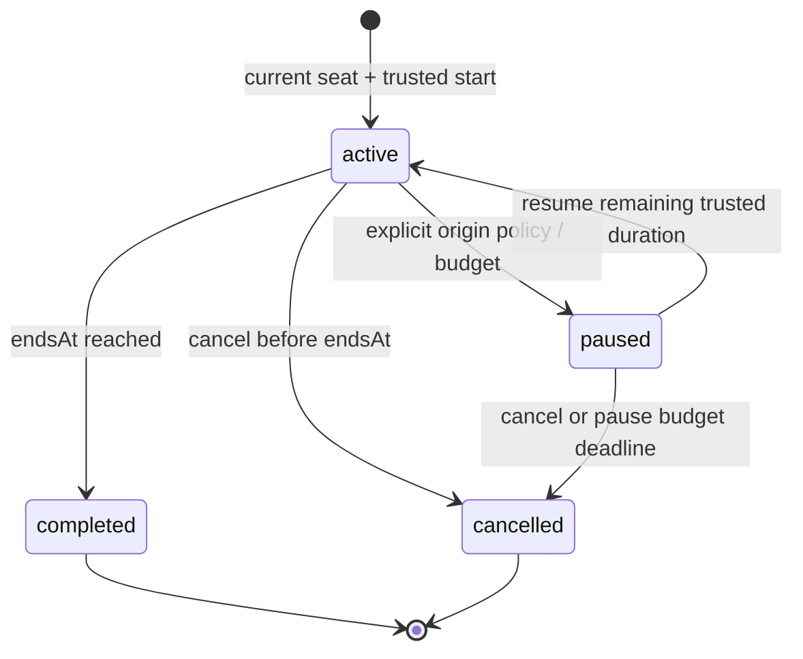

# Trusted Focus Engine

M10-01 source comparison is in FOCUS-COMPATIBILITY.md. M10-02 implements the private server lifecycle/API; no live browser timer is claimed until M10-04. SDK Sandbox is explicitly focus-capable with pause denied; synthetic integration tests additionally supply an opt-in paused-library policy. These are not integrated legacy worlds.

## API and Authority

| Endpoint | Strict v1 behavior |
| --- | --- |
| POST /v1/focus | schemaVersion1,source{epoch,roomId,membershipId},durationSeconds900/1500/3000; authenticated current seat in focus-capable world required; UUID Idempotency-Key/Origin/CSRF;201 own canonical timer |
| GET /v1/focus | Own current active/paused or latest terminal timer plus serverTime;null when none |
| GET /v1/focus/:id | Own canonical current/terminal timer; another account gets404 |
| POST /v1/focus/:id/pause,resume,finish,cancel | Body schemaVersion1 only,UUID key/Origin/CSRF; policy-gated trusted transition; no client time/completed/notes/reward field |

Results contain schemaVersion1,serverTime and nullable session with id,phase,duration,start/end/change/pause timestamps,remainingMs,canPause,pauseBudgetMs and immutable origin{worldSlug,roomId,seatId}. IDs/timestamps are canonical observations,not room access tokens. Account-scoped idempotency fingerprints bind operation/input; same key with changed input conflicts. A replay returns the original timer's current observation and cannot repeat pause/start or resurrect terminal state. One running/paused timer per account spans all sessions/tabs,even after moving worlds. New start reconciles expired prior timers before applying uniqueness.

Source authorization runs in the owner queue and an account-locked SQL transaction. Only the trusted definition sets pauseAllowed. Actual membership,active session attachment and seat are required; another user's room/source or arbitrary claim cannot start focus. Existing focused history remains privately readable/cancellable/finishable after leaving or while world entry is restricted,without supplying admission permission. No public location/status/activity feed is added.

## Clock and Lifecycle

Original duration remains15/25/50min. Active endsAt is trusted; remaining display is derived without per-second writes. Server finish before endsAt rejects. At the exact deadline completion wins over cancel/pause. Completed changedAt is the original trusted end instant,not a late browser callback. Terminal retries do nothing beyond observing current state. Completion is a timer outcome,not evidence of work quality or attention. No reward/coin counter exists.

Default Deadline mode cannot pause. An explicit paused mode freezes remaining duration and grants at most10min cumulative pause across the whole timer. Resume subtracts elapsed pause budget and starts a new trusted end from remaining duration; there is no arbitrary extension field. Pause deadline cancellation gives no completion. Backward trusted time rejects the transition. Browser sleep,disconnect,room leave/seat release,session renewal/login and process restart cannot manufacture or erase completion; database read/maintenance reconciles the timer.

## Ownership and Retention

Migration0012 creates engine_focus_sessions/mutations,one running account partial unique index,monotonic history order and state constraints. No FK points to ephemeral room tables; origin context stays immutable data and never authorizes a future room command. Account deletion cascades,upgrade/login retains account ownership,export is private/bounded100 plus truncation and excludes fingerprints/source grants. No task note is accepted or stored. New starts12/hour and new commands120/hour/account are durable local abuse limits; exact retries reuse receipts. Bounded maintenance reconciles at most100 active deadlines/100 paused deadlines and purges100 terminal rows older than90days with receipt cascades. These defaults require policy approval before public use.

Rollback closes entry points while retaining additive private history; no automatic destructive migration or legacy import. See ADR0024 for transaction/SDK changes and verification limits. Scoped history/privacy,M10-04 accessible UI/sharing and M10-05 timezone/DST summaries remain unfinished. All actual world rollout/public/staff flags remainOFF.
