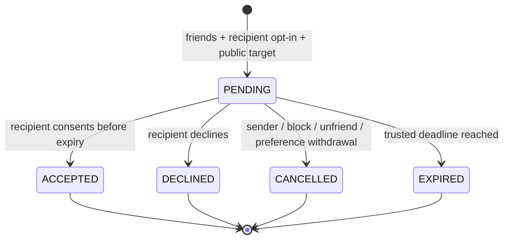

# Invitations

M09-03 adds a consent inbox at `/invitations`, linked from `/social`. Recipient opt-in is OFF by default. Current friendship and bilateral block priority are checked on create/respond/list. Sending proposes an available listed public world. M17-04extends this with an optional exact public room offer,explicitly selected by the sender. Hidden/private/adult targets remain unavailable. No arbitrary message/URL payload is accepted.

## Public room offers — M17-04

InvitationDestination may carry an optional roomId UUID. Existing world-only inputs are unchanged;this is a prerelease schema extension and older strict readers must upgrade with the portal. The destination remains in the existing JSONB field,with no migration. A trusted room-owner port verifies current public listed world/room association,actor permission and asset versions for creation and acceptance. A missing/foreign room fails404. Capacity is checked only during actual admission;an invitation holds no place or desk.

Library's current-visit form sends this explicit room offer to a friend who permits invitations. Sender chooses to share that public room metadata;it does not make general presence tracking public. Recipient accepts,then sees Review invited room linking to strict travel confirmation. Acceptance creates no membership or RSVP. The same server validates current scope/capacity again,so a stale/full room preserves the source and has no silent fallback. A later block or invitation opt-out removes contact authorization even for earlier offers. Actual tests and limits are in ADR0054/m17-sharing-checks.json.

## API

| Endpoint | Strict v1 behavior |
| --- | --- |
| GET /v1/me/invitations/settings | Own schemaVersion1/allowInvitations, default false |
| PATCH /v1/me/invitations/settings | Same strict fields, UUID Idempotency-Key and Origin/CSRF; disabling closes incoming pending offers |
| POST /v1/invitations | schemaVersion1, recipientId, destination{worldSlug,worldVersion,sceneVersion};201 receipt only |
| GET /v1/invitations | Own incoming/outgoing projection, limit1-50/default20 and optional UUID cursor; current authorized contact profile and public destination only |
| POST /v1/invitations/:id/respond | schemaVersion1/action accept,decline,cancel; recipient alone accepts/declines,sender alone cancels; UUID key and Origin/CSRF |

Unknown authority/free-text/room/TTL/query fields are rejected; errors do not disclose why a recipient or private destination is unavailable. Receipts contain id,state,createdAt,expiresAt,schemaVersion. They never carry a travel capability. The same request key observes the same current receipt with original deadline; altered input conflicts. A second pending directional pair conflicts. Terminal responses never reverse or revive an invitation. Read pagination can produce an empty filtered page with a next cursor; clients can continue without access to hidden metadata.

Maximum TTL120000ms; retries never extend it. Server time is authoritative. Lists/response/creation replacement expire old pending rows; bounded maintenance covers inactive inboxes. Accept versus block is serialized through account locks and current relationship guard; block can follow an accepted historical outcome but immediately hides it and prevents replay from granting current authority. Pending cancellation is transactional with social withdrawal. Re-enabling/unblock/re-friend never revives pending offers.

## Privacy and Delivery

`invitation.received` and `invitation.responded` contain only `{schemaVersion:1}` and route to the two account sessions, never a public room/global feed. They ask the client to reread current authorization, and carry no location/world/profile/receipt IDs or counts. No hint on rejected creates or exact retries. Hints are best-effort: offline inbox data remains in PostgreSQL and refreshes on reconnect. No presence/online claim or capacity reservation is inferred from delivery/acceptance. Hidden dating/restricted contexts cannot enter the notification metadata.

The browser clears stale projections on connection/identity loss or relationship changes, refreshes on reconnect and at pending deadlines, preserves uncertain mutation keys, disables repeated writes while pending and offers explicit refresh. Native select/checkbox/buttons provide keyboard/touch controls. UI success says the room has not changed after acceptance. The eventual travel handoff must use a fresh session/source-scoped authorization; accepting an offer supplies no permission to bypass flags, safety, adult proof, private access or capacity.

## Ownership and Operations

See ADR0019 for transaction/pool boundaries and scope. Migration0009 owns preferences, invitations and metadata receipts. Six creates/minute and20/hour per sender survive API restart and independent sessions, with50 pending incoming maximum. Lists bounded to50, own exports100 plus truncation. Account deletion cascades, terminal metadata purges after24h in batches, preference mutation receipts also expire. No raw request body or invitation route ID is logged. These defaults need privacy/operational review before public use.

Rollback closes invitation routes/UI while retaining additive tables. All real flags stay OFF; no legacy sources or production databases are changed. M09-04 now provides a separate authenticated socket handoff; ordinary accept still never triggers it.

## M09-05 Group Consent Windows

`POST /v1/invitation-groups` accepts strict schemaVersion1, two to four distinct recipientIds and a public versioned destination. Authenticated Origin/CSRF and UUID Idempotency-Key are required. `GET /v1/invitation-groups/:id` is sender-only; other parties including recipients get404. Both use existing HTTP limits. No group bearer token, arbitrary text, room ID, online count or forced travel is added.

A result contains opaque group ID/common expiry, ordered positional statuses, optional own child invitation IDs, acceptedCount/pendingCount and PENDING/ALL_ACCEPTED/PARTIAL/CLOSED completion. Known unavailable/rate-limited/conflicting recipients are explicit independent outcomes. A successful child can remain pending while an offline recipient does not connect; no offline/online status is inferred. Read/retry reapplies current block/friendship/preference/public-world disclosure. Recipients receive only their ordinary private invitation. Sender results never disclose new peer identities or other people's location.

Children share a common maximum2min deadline and existing sender6/minute+20/hour rate cap. Roots add3/minute/max4children. Durable positional child keys resume interrupted fan-out after a committed invitation loses its link/response; retries never duplicate children or extend expiry. Expired unfinished positions close as EXPIRED. No implementation worker continues sending in the background. Failures from storage or unknown errors remain failed requests with resumable durable progress.

The UI at `/invitations` offers native checkbox selection and a separate group destination; it displays accepted/pending/closed counts and per-position outcomes. Everyone accepts/declines independently. No place is reserved until their own M09-04 request, and bounded holds remain expiry/cancel controlled. Capacity is never multiplied by a group token. Groups can split across rooms; persistent PartyMembership/automatic whole-group teleport and seating guarantees are not provided. See ADR0021 for scope and migration0011/export/erasure/rollback details. Browser travel confirmation and cross-world routing remain M09-06.
