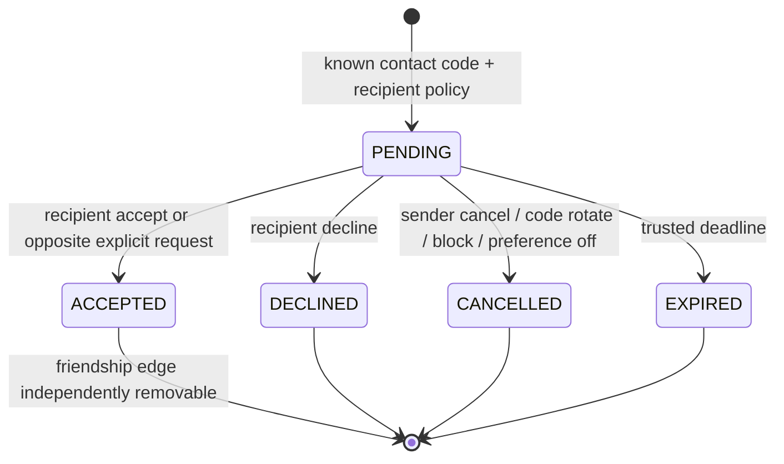

# Social API v1 (M04)

All routes require an active signed city cookie. All mutations require exact Origin, CSRF and UUID Idempotency-Key. Body actor/role fields are forbidden. A valid contact code grants only permission to request friendship, never identity/session/world access. No global profile search or DM endpoint exists.

| Route | Meaning / response |
|---|---|
| GET /v1/social/me | Own stable contact code and code/none request preference; initializes missing defaults only under own account lock |
| PATCH /v1/social/me | Strict requestPolicy; none cancels pending incoming requests |
| POST /v1/social/contact-code/rotate | Replaces own code and cancels pending incoming offers; old code no longer resolves |
| POST /v1/friends/requests | Strict contactCode; pending outcome or reciprocal acceptance; no recipient name/ID in response before consent |
| GET /v1/friends/requests | Own pending incoming/outgoing offers; cursor/limit<=50; incoming sender has intentionally shared public profile, outbound has only code hint |
| POST /v1/friends/requests/:id/respond | accept/decline recipient-only, cancel sender-only; expiry authoritative |
| GET /v1/friends | Accepted friends, public profile allowlist and optional privacy-filtered activity; cursor/limit<=50 |
| DELETE /v1/friends/:id | Unfriend; repeated/historical accepted requests never restore the edge |
| POST /v1/blocks | Own targetId/blocked choice; bilateral contact denial, remove friendship/cancel pending offers; unblock never restores friendship |
| GET /v1/blocks | Own confidential block list; known name snapshot only, no target's subsequent profile changes |

Requests use states PENDING/ACCEPTED/DECLINED/EXPIRED/CANCELLED. Unordered pair columns are generated by PostgreSQL; unique partial index prevents both-direction pending duplicates. Friendship pair PK/check prevents duplicate/self edges. Platform identity-account advisory locks acquired in canonical order coordinate social transitions with profile/session/deletion operations. Session is reauthenticated within the same transaction; notifications happen after commit. Blocks have no authorization cache and are read on each contact/projection action.

Receipts replay original transition outcomes, not a promise of current friendship. Current graph/list policy is authoritative. Current block/request restrictions run before serving old send/respond receipts; no replay bypass. Unfriend does not mutate old accepted request history or implicitly renew consent. UI messages say request processed and refresh the current graph.

Bounds: 20 new outgoing records/actor/rolling day persisted in DB; 100 pending inbound offers/recipient; 500 friends and 500 own blocks; 30 social writes/token/min and 300 social HTTP requests/IP/min with bounded limiter storage. Counts are policy limits, not measured concurrency/throughput claims. Daily-cap hook reports only actorId/REQUEST_LIMITED to trusted moderation consumers; M08 operational reporting/moderation remains unimplemented. Private records are not room/global events.

`friendship.changed` is account-scoped `{schemaVersion:1}` only, over the authenticated M03 gateway. It never includes identities, block reason, world, presence, preferences or raw text. Clients re-fetch authoritative own lists. UI handles expired sessions, private blocks, current request settings, native accessible controls, pagination and stale refresh cancellation; checkbox draft reverts if a write fails. Browser E2E verifies two independent contexts, live notifications, guest upgrade continuity, block/unblock and preference persistence.

Presence source is a server `SocialPresencePort.visibleActivity(viewer,target)` policy interface. Default source returns no activity because rooms do not exist yet. M06/M05 must supply authoritative, viewer-eligible activity; no fabricated offline/online count. Social always applies accepted-friend/bilateral-block checks and identity-owned per-world visibility again. Dating and unknown worlds are never globally projected. Integration tests use a clearly labeled controlled source to test privacy across all world keys; they do not verify those worlds as playable.

Deletion cascades affected settings/requests/edges/blocks/receipts through identity FK lifecycle; unrelated accounts/blocks remain. Identity export invokes the social owner reader for only that account's records; another user's private blocks/preferences are omitted. Pending expires seven days, closed records purged 30 days beyond original expiry, mutation receipts 24 hours. Registered upgrade retains account ID, contact code and graph. No legacy schema/source changed, no production migration or public release.
