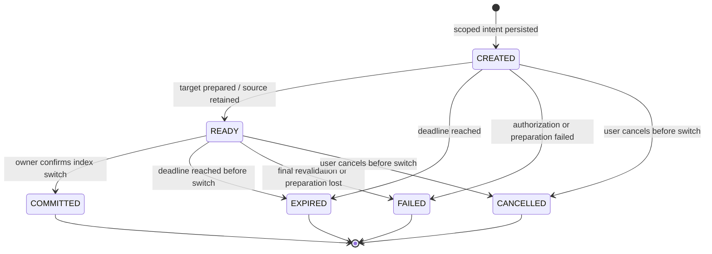
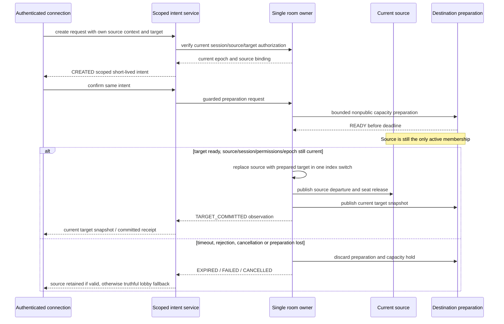

# Travel Lifecycle and Admission Boundary

M09-01 defines the lifecycle; M09-02 adds scoped durable authorization and HTTP issuance/read/cancel. M09-04 adds a socket coordinator with separate target preparation, bounded capacity holds and an owner-serialized membership switch. Browser travel routing remains M09-06. Ordinary room.join still rejects a different current membership. See ADR0017/0018/0020 and the M09 checkpoints for verified scope.

## Audit

| Existing owner | Observed behavior and implication |
| --- | --- |
| RoomService | One account-to-room index and connection-to-membership binding, one serialized command queue, epoch UUID,15s disconnected grace, bounded receipts; another world requires leaving today. Handoff must preserve the one-active-membership invariant rather than bypass it. |
| WorldRegistry | Fresh session/access/flag/version and membership authorization before trusted join/leave hooks. A prepared destination needs a distinct private capability; ordinary membership must not be fabricated to bypass hooks. |
| RoomAuthority | One PostgreSQL advisory-lock owner/schema; authority loss discards runtime rooms and requires restart. No distributed owners/leases. Durable travel metadata cannot resurrect an old room epoch. |
| Safety | Current sanctions and incident overlay guard registry/admission/chat; closure and sanctions serialize with room publication. Travel must use these same current guards, including final publication. |
| Social/identity | Per-viewer block/context/privacy filtering; no global friend location authority. Invitation consent and privacy must be rechecked, not inferred from knowing a world/room UUID. |

## State Model

`apps/platform-api/src/travel/lifecycle.ts` validates private schemaVersion1 state with phase,createdAt,expiresAt,changedAt in integer trusted milliseconds. Maximum preparation TTL30000ms is a local engineering default; the service also bounds it by session expiry. Original expiry never extends on retry. A backwards/unsafe clock or malformed persisted state is rejected. States returned by the reducer are frozen.

At the exact expiry boundary, expiry wins over readiness/commit/fail/cancel. Timeout polling before expiry and duplicate readiness are no-ops. CREATED cannot consume TARGET_COMMITTED. Terminal retries return the same terminal observation and original timestamps; they do not reapply admission, extend expiry or reactivate capacity. A COMMITTED receipt remains historical after its deadline; it does not imply a current live target membership.

The owner must supply the trusted transition/linearization timestamp. A delayed browser ACK is never a commit event, and its arrival time must not turn a completed before-deadline switch into an expiry or authorize a new switch.

## Owner Protocol for Subsequent Tasks

M09-04 implements this protocol for the single exclusive owner with synthetic targets. A separate hold counts toward target capacity without entering active membership indexes. Preparation hooks run outside the owner queue; final source/target validation and index replacement serialize within it. See the transaction/acknowledgement limits below; the diagram is not evidence for distributed owners or integrated legacy worlds.

## Failure and Privacy Rules

| Trigger | Required behavior in M09-02..06 |
| --- | --- |
| Double click, altered request or another session | Durable request fingerprint + scope; same retry observes current state, changed input conflicts, one consumption only. Lifecycle terminal handling alone does not authorize a request. |
| Destination full/private/disabled/restricted/banned | Reject before source release; inaccessible target metadata remains undisclosed. Owning a token or accepting an invite never supplies missing adult/staff/private permission. |
| Source leave/change, logout, source epoch reset | Revalidate the original source/session binding; never reinterpret an old intent against a new membership. Source loss may require an explicit lobby fallback. |
| Client disconnect or delayed ACK | Do not infer failure or success from transport silence. Reconcile intent + current own membership; old callbacks cannot create a second admission. |
| Owner restart/loss after persisted receipt | Old epoch admission is invalid. No automatic replay of old target joins; current authority and a fresh guarded admission or truthful interruption are required. |
| World/sanction/incident change during preparation | Recheck at commit and publication through shared gates; invalidate destination hold. Recovery of a flag does not resurrect an old intent. |
| Cancel/expire concurrent with commit | Owner serialization and durable compare/consume determine one terminal outcome. An ACK retry cannot reverse it. |
| Another tab/session | Account remains in one active room, source tabs receive truthful invalidation or coordinated target snapshots; never keep stale source seats/commands alive. |
| Hidden/dating presence or blocked invitation | No generic notification/global activity leaks source/target metadata; consent and current bilateral block priority. No query-string bearer tokens or raw token/body logging. |

## M09-02 Authorization API

| Endpoint | Behavior |
| --- | --- |
| POST /v1/travel-intents | Authenticated Origin/CSRF-protected create, UUID Idempotency-Key; strict schemaVersion1, source null or exact epoch/roomId/membershipId, destination worldSlug/worldVersion/sceneVersion with optional roomId. Returns201 with own current receipt and capability only before redemption while CREATED. |
| GET /v1/travel-intents/:id | Same account AND session only; current phase, destination, createdAt/expiresAt, redeemed and capability:null. Other sessions, even the same registered account, get404. |
| POST /v1/travel-intents/:id/cancel | Same authorization, Origin/CSRF and UUID key; empty body. Terminal/current observation is idempotent. No membership changes. |

Unknown body/query/authority/redirect fields are rejected. There is no HTTP redeem route. Trusted `TravelService.redeem` requires the original session, intent UUID, UUID request key and exact capability. It rechecks current owner/source/target, atomically consumes once, returns a scoped coordinator observation and leaves CREATED unchanged. Replaying a different key conflicts; a matching retry rechecks current access and cannot create a second authorization. M09-04 must perform fresh final admission and persist subsequent lifecycle transitions; this port cannot prove target readiness.

The capability uses a purpose-separated HMAC bound to account/session/intent/scope/epoch/expiry; only its hash is stored. Creation retries reproduce the same capability until consumption, then return a capability-free receipt. GET/export never returns one. No query bearer or raw request body is logged; intent IDs are redacted from route logs. Receipt replay conveys historical authorization, not proof that current target access still exists.

Migration0008 stores one active intent/account and body-free mutation fingerprints, guarded by identity account transaction locks. Six creations/account/minute survive API restart while their sessions remain stored. Session/account deletion cascades authorization/receipts; session rotation/revocation independently fails authentication. Bounded maintenance expires live intents and purges terminal records older than24h; these local retention defaults require human policy review before public operation. Own export returns at most100 metadata-only receipts with explicit truncation. No peer activity/notification is emitted.

Source membership and target checks execute through the existing serialized room owner; no capacity is reserved during HTTP/database latency. A source leave, full destination, access change or expiry can invalidate a previously issued capability. Actual switch authority must never rely on a stale observation. Additive rollback and remaining implementation obligations are documented in ADR0018.

## M09-04 Socket Handoff

`travel.request` accepts strict `{schemaVersion:1,requestId,intentId,capability}` after authenticated gateway/session guards. Maximum2 pending/socket and64 coordinator jobs; same-key/session/connection retries share one job. ACK success contains `{schemaVersion:1,receipt,snapshot}` with snapshot null when a historical committed receipt cannot establish a current target. No raw capability enters the ACK, logs or notifications. Private `travel.accepted/failed` hints contain only schemaVersion/requestId; acceptance is emitted only with a current target snapshot.

Adapters must explicitly implement registry travel prepare/abort/depart. These hooks receive AbortSignal/deadline, never ordinary active membership authority. Preparation retains source seat/membership, counts one bounded target hold and allows other owner commands to run. Failed settled preparation runs abort; a nonsettling hook or failed cleanup quarantines the adapter. Each hook/queue wait has a500ms cap, bounded by original intent expiry. Quarantined adapters cannot reactivate in process; uncooperative external resource cleanup remains an operational limit, not a claimed success.

After target confirmation, READY is durable. Final owner validation rechecks source/connection/session/epoch, current target/private/adult/safety/version/flags and preparation validity. Account-locked SQL verifies phase/session/deadline again, writes historical target IDs, then replaces source/target indexes synchronously before COMMIT. Events and target snapshot wait for the acknowledged transaction. A rejected transaction restores original source/seat/tab connections without publishing speculative joins/leaves. If acknowledgement is lost after the DB actually commits, runtime conservatively restores source and retry returns historical COMMITTED with null snapshot. The retry cannot silently switch again. Restart similarly requires fresh membership; old target IDs provide no admission authority.

Source release invalidates all old tab commands; requesting connection receives target, other source tabs get ended and must reconcile. Current policy/authority loss after commit removes target and returns null/lobby. Source resources that have already departed are not recreated. Source cleanup failure quarantines that world, while an independent confirmed target can remain active. Viewer-specific target snapshots retain identity/avatar and current privacy/block rules. There is no global location broadcast.

Migration0010 adds nullable target_room_id/target_membership_id constrained to COMMITTED records. ADR0020 documents linearization, failure recovery, rollback and trusted hook limitations. No real world is enabled. M09-03 invitation consent remains distinct; accept creates no automatic transfer. M09-05 group/offline behavior and M09-06 browser routing/network fault acceptance remain unfinished.

One owner, synthetic fixtures and all real flagsOFF remain the current operating scope. No cross-process handshake, durable room recovery, real Deadline/Maid integration, party, public release or browser travel success is claimed here.
