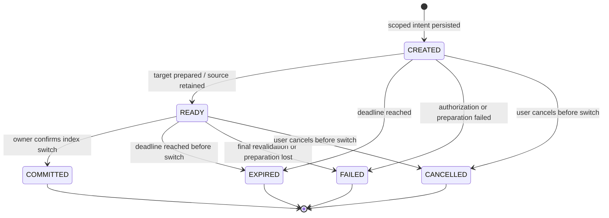
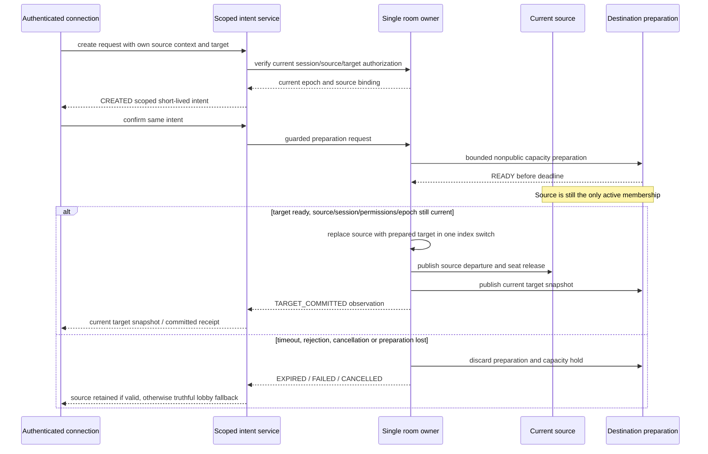

# Travel Lifecycle and Admission Boundary

M09-01 implements an executable lifecycle model, strict shared phase vocabulary and the protocol below. It does not move a player. There is no travel endpoint, token, destination reservation or travel UI yet. Existing room.join still rejects a different current membership. See ADR0017 and the M09 checkpoints for verified scope.

## Audit

| Existing owner | Observed behavior and implication |
| --- | --- |
| RoomService | One account-to-room index and connection-to-membership binding, one serialized command queue, epoch UUID,15s disconnected grace, bounded receipts; another world requires leaving today. Handoff must preserve the one-active-membership invariant rather than bypass it. |
| WorldRegistry | Fresh session/access/flag/version and membership authorization before trusted join/leave hooks. A prepared destination needs a distinct private capability; ordinary membership must not be fabricated to bypass hooks. |
| RoomAuthority | One PostgreSQL advisory-lock owner/schema; authority loss discards runtime rooms and requires restart. No distributed owners/leases. Durable travel metadata cannot resurrect an old room epoch. |
| Safety | Current sanctions and incident overlay guard registry/admission/chat; closure and sanctions serialize with room publication. Travel must use these same current guards, including final publication. |
| Social/identity | Per-viewer block/context/privacy filtering; no global friend location authority. Invitation consent and privacy must be rechecked, not inferred from knowing a world/room UUID. |

## State Model

`apps/platform-api/src/travel/lifecycle.ts` validates private schemaVersion1 state with phase,createdAt,expiresAt,changedAt in integer trusted milliseconds. Maximum preparation TTL30000ms is a local engineering default; the eventual service must also bound it by session expiry. Original expiry never extends on retry. A backwards/unsafe clock or malformed persisted state is rejected. States returned by the reducer are frozen.

At the exact expiry boundary, expiry wins over readiness/commit/fail/cancel. Timeout polling before expiry and duplicate readiness are no-ops. CREATED cannot consume TARGET_COMMITTED. Terminal retries return the same terminal observation and original timestamps; they do not reapply admission, extend expiry or reactivate capacity. A COMMITTED receipt remains historical after its deadline; it does not imply a current live target membership.

The owner must supply the trusted transition/linearization timestamp. A delayed browser ACK is never a commit event, and its arrival time must not turn a completed before-deadline switch into an expiry or authorize a new switch.

## Owner Protocol for Subsequent Tasks

This diagram specifies obligations, not a completed room handoff. The eventual linearization point must be one owner-serialized switch after fresh target confirmation; intermediate preparation is never a second active account membership or normal destination authority. Capacity counts active plus bounded preparations. No observer may see two active memberships. Awaited hooks cannot create an unguarded publication window. Source departure failure must not invent successful target activity. Target rollback/cleanup and resource-owning hook deadlines need explicit implementation/evidence.

## Failure and Privacy Rules

| Trigger | Required behavior in M09-02..06 |
| --- | --- |
| Double click, altered request or another session | Durable request fingerprint + scope; same retry observes current state, changed input conflicts, one consumption only. Lifecycle terminal handling alone does not authorize a request. |
| Destination full/private/disabled/restricted/banned | Reject before source release; inaccessible target metadata remains undisclosed. Owning a token or accepting an invite never supplies missing adult/staff/private permission. |
| Source leave/change, logout, source epoch reset | Revalidate the original source/session binding; never reinterpret an old intent against a new membership. Source loss may require an explicit lobby fallback. |
| Client disconnect or delayed ACK | Do not infer failure or success from transport silence. Reconcile intent + current own membership; old callbacks cannot create a second admission. |
| Owner restart/loss after persisted receipt | Old epoch admission is invalid. No automatic replay of old target joins; current authority and a fresh guarded admission or truthful interruption are required. |
| World/sanction/incident change during preparation | Recheck at commit and publication through shared gates; invalidate destination hold. Recovery of a flag does not resurrect an old intent. |
| Cancel/expire concurrent with commit | Owner serialization and durable compare/consume determine one terminal outcome. An ACK retry cannot reverse it. |
| Another tab/session | Account remains in one active room, source tabs receive truthful invalidation or coordinated target snapshots; never keep stale source seats/commands alive. |
| Hidden/dating presence or blocked invitation | No generic notification/global activity leaks source/target metadata; consent and current bilateral block priority. No query-string bearer tokens or raw token/body logging. |

One owner, synthetic fixtures and all real flagsOFF remain the current operating scope. No cross-process handshake, durable room recovery, real Deadline/Maid integration, party, invitation, public release or browser travel success is claimed by M09-01.
