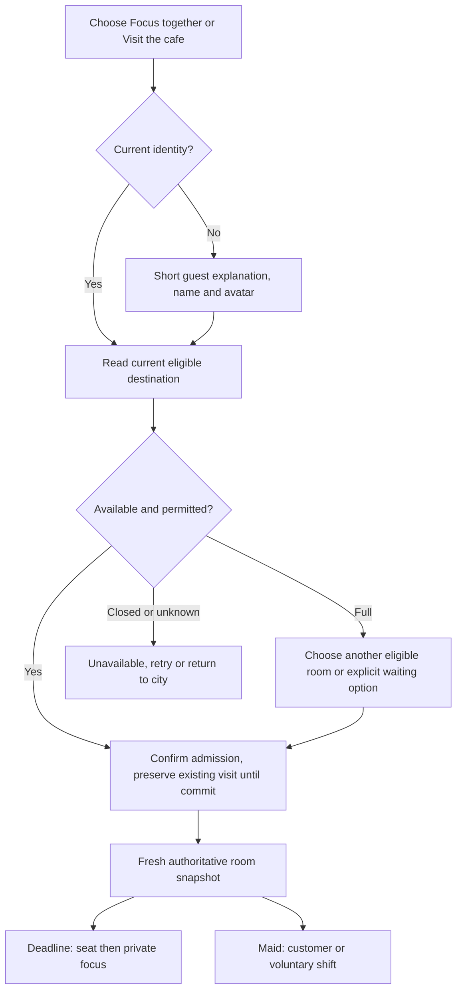

# N06-01 — player journeys and visual direction

Decision date: 2026-11-05. Source reviewed at `efe5889`: home/CityMap, WorldRoomPanel/Pixi mount, existing focus/service controls, approved original scene provenance and three historical screenshots. Owner authorized routine design choices. This is a design specification; current routes retain behavior until N06-03/04 passes its implementation gates. It is not a human usability result.

## Product decision

Home opens with **Focus together** and **Visit the cafe**, then a smaller consenting-friends entry. Offer only currently permitted destinations; never advertise a closed/private world to make the city look populated. An existing valid activity may get **Return to your place** after a fresh server read. Move database/schema/health/operator details out of the player journey into the later admin/developer surface. A truthful general availability error remains player-visible.

Polish two loops: Deadline **enter → choose seat → focus → finish/cancel → return**, and Maid **enter → customer or voluntary service → order/course → acknowledge completion → continue or leave**. Other implemented worlds stay accessible through appropriate discovery but are not added as a substitute for these loops. No forced chat, role, autoplay, reward animation or friend disclosure.

**First meaningful action <60 seconds is a draft target**, excluding separately reported admission wait; it has not been measured. Meaningful action means a server-confirmed seat plus focus start, or a canonical first order/service step. A page view, guest creation or decorative click does not qualify. Retention requires consented real cohorts later; no D1/D7 claim is made here.

## First play and return

Guest copy explains browser-only identity and the risk of losing it on logout; upgrade is optional and does not block the first activity. Registration/recovery limits remain truthful. Safety/privacy choices retain conservative defaults. Avoid gathering a task title, real name, photo or contact details for the focus loop.

Returning users receive current server identity/visit/focus data. A historical receipt or cached screen is never a live membership. If a visit expired, offer a new admission without auto-selecting a seat or resuming a shift. A retained private focus timer uses its original trusted timestamps; cancelled/complete activity is history. Refresh failures show **Unable to check your place** with retry, not a fake empty city or an automatic new guest.

## Room loops and negative actions

| Moment | Deadline | Maid | Authority / feedback |
|---|---|---|---|
| Enter | Scene with available desk choices | Scene with customer / voluntary service choice | Entry is pending until server confirms; room occupancy is a dated observation |
| First action | Select a desk; start private timer | Customer chooses virtual item, or staff explicitly starts an allowed shift and claims eligible work | Highlight intent immediately, success only after canonical response; same-key retry for uncertain result |
| Progress | Small timer HUD and optional seat list | One current course/preparation action at a time | Trusted deadlines and course/version state; no client completion/reward authority |
| Conflict | **That desk was just taken**; refresh free choices | **Someone else claimed this order**; return to current eligible queue | Keep the room; do not reload identity or fabricate success |
| Finish | Server completion summary or explicit cancel | Customer acknowledgment after served courses; exactly one completion | Optional private reward/outfit only when enabled and authorized; no public productivity ranking |
| Exit / travel | Explain active timer policy before leaving; preserve history | Stop voluntary shift independently; unfinished work requeues under current rules | Negative actions remain reachable during a pending positive operation; late replies cannot restore withdrawn activity |
| Safety | Contextual report/block, private receipt | Same platform safety controls with relevant contact context | Block/revoke affects server audience and future contact; report does not announce reporter or auto-sanction |

## Full, waiting, offline and reconnect

Queue is a **planned N09 state**, not an existing platform admission promise. Before it exists, full-room UI offers currently supported alternatives/retry; no fake rank, countdown or ticket. The N06-02 prototype labels all queue data as simulated.

| State | Primary copy / action | Required guard |
|---|---|---|
| Loading | **Checking your place…** | Keep only known context; cancel/back available; bounded timeout |
| Empty | **Be the first to settle in** / choose an eligible room | No invented peers or fake occupancy |
| Full | **This room is full** / other eligible rooms or explicit wait when implemented | Preserve source visit until target commits |
| Waiting | **Waiting for a place** / leave queue; rank/ETA only if observed and fresh | One account ticket/slot; no false precision; refresh stale estimates |
| Offer | **Your place is ready** / accept before server deadline or decline | Acceptance/expiry revalidated atomically; never auto-enroll |
| Offline | **You’re offline. Changes aren’t confirmed.** / retry when online | Disable positive mutations; private known history may remain labelled stale |
| Reconnecting | **Reconnecting to your room…** / leave or return | Obtain epoch/snapshot and reconcile receipt before enabling commands; no duplicated room/seat/order |
| Denied / revoked | **This place isn’t available to you** / return to city; safety/account access remains independent | No private reason/room disclosure or client-side role override |
| Asset failure | **Scene unavailable. Use room controls.** | Native semantic controls still operate on server authority |

Travel changes destination only after confirmation. Lost ACK resolves via own current state/receipt read; do not issue a new random key to guess at completion. After server restart, display a new-visit path rather than reviving old room authority. Reconnect is not evidence that an interrupted service completed.

## Direction board: calm room, warm service

Use the existing code-authored pixel city and cafe art. Keep clean silhouettes, restrained shading, readable seats and one clear selection ring; use high-contrast DOM text around the canvas. No new external image/audio/font dependency. Preserve source geometry, seat IDs and server movement; appearance grants no gameplay role.

| Token direction | Value / use |
|---|---|
| Canvas / surface | `#f5f4ee` warm neutral / `#ffffff` controls |
| Ink / secondary | `#172d2a` primary / `#435b53` supporting copy |
| Forest accent | `#225c49` actions and confirmed selection |
| Clay accent | `#b85b49` restrained cafe detail; do not use as small text without contrast check |
| Danger | `#a12232` with explicit text/icon, never color alone |
| Spacing / shape | 4/8/12/16/24/32; 8px controls, 16px panels; body at least 16px |
| Input | At least 44px targets, visible focus, logical tab order, labelled controls |
| Motion / sound | Honor reduced motion; no idle animation requirement; sound OFF until explicit opt-in and approved assets exist |

Desktop: room scene is the main area, compact activity HUD, one right-side contextual panel. Mobile at 360px: scene and current action first, three stable destinations (City, Activity, Safety), one bottom sheet at a time with safe-area padding and scrollable content above the keyboard. Wardrobe, roster, chat, events and controls do not all occupy the primary view. Sheet opening moves focus, Escape/close returns it, and independent Leave stays reachable. Text scaling must not hide actions.

### Historical source screenshots — inspected, not a new app run

Historical portal desktop: technical status and long map/list before activity

[Historical synthetic account portal screenshot with platform status above the city map and long catalog](https://github.com/tiecont/virtual-life-platform/blob/cef7dc17172f7c6cda930c99648a5e3ad609cc55/docs/agent/evidence/m16-portal-journey/desktop-city.png)

Historical Deadline mobile: scene and focus separated by long native seat controls

[Historical Deadline mobile layout with native controls and the private focus timer below the seat list](https://github.com/tiecont/virtual-life-platform/blob/cef7dc17172f7c6cda930c99648a5e3ad609cc55/docs/agent/evidence/m15-deadline-scene-page-mobile.png)

Historical Maid scene: original warm cafe geometry and shared avatars to retain

[Historical original Cafe Sakura scene with numbered tables, warm floor colors and shared starter avatars](https://github.com/tiecont/virtual-life-platform/blob/cef7dc17172f7c6cda930c99648a5e3ad609cc55/docs/agent/evidence/m16-native-visual/mobile-scene.png)

The screenshot names denote earlier controlled browser profiles, including synthetic test identities. Their hashes and associated source provenance are in [SOURCE-REFERENCES.json](SOURCE-REFERENCES.json). The immutable screenshot links require access to the existing private repository; [indexed retrieval](../../evidence/STORE.md) preserves byte verification. They are reference material, not current screenshots, performance data or human usability approval. All existing scene distribution approvals remain false.

## Walkthrough and handoff

Source review confirms that home currently exposes schema status, WorldRoomPanel dynamically mounts Pixi, and native controls and server-owned focus/service/safety behaviors already exist. The proposal changes presentation and ordering, preserving those owners. Review walked first guest, returning visit, seat/order conflict, full/wait, lost ACK, asset failure, logout/revoke and independent withdrawal states; unimplemented queue/native states stay labelled proposals.

N06-02 makes a desktop/mobile interactive state prototype and reusable tokens; its review covers 360px layout, keyboard/focus, text scaling, reduced motion and no false state success. N06-03/04 wire actual shared client only after protocol and extraction dependencies are VERIFIED. N06-05 requires actual target users and assistive-tech review; no synthetic walkthrough substitutes for them.
