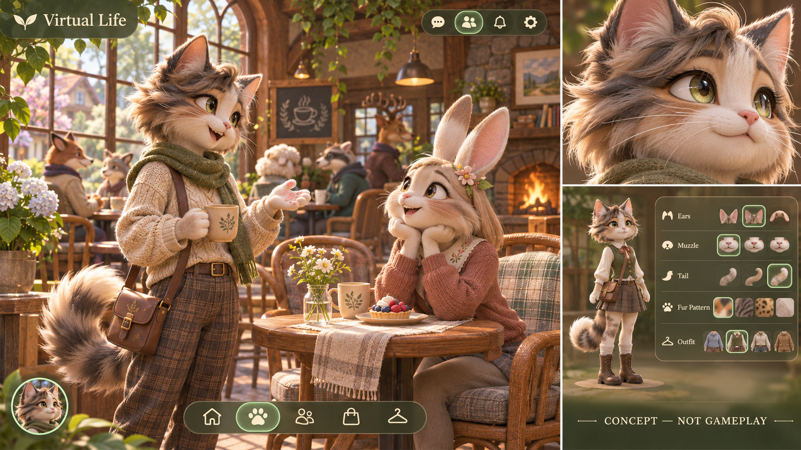

# Animals3D — look development reference, revision1

Owner requests a substantial visual upgrade: animated3D animals, detailed fur, part-based creation and polished landscape gameplay on web/mobile. This folder is N06-10 **design/pipeline preparation**, not a delivered3D game, exported mesh/rig or owner art approval. The current product still renders the previously qualified pixel room until later renderer/creator/scene tasks land.

The built-in image_gen tool generated this raster reference from [the exact prompt](CONCEPT-PROMPT.txt). The selected PNG is copied into the workspace without editing; provenance/hash and current approval state are in `provenance.json`. It is not substituted for runtime screenshots or loaded by the game. No third-party mesh/groom/animation rights are inferred from it.

## What to preserve in the real3D implementation

- Distinct feline/rabbit silhouettes; layered wet eyes, shaped muzzle, ear translucency and directional fur clumps with finer silhouette hairs. Fur should feel soft under light rather than noisy plastic. Dog receives equivalent authored anatomy/ear/muzzle/coat treatment in the starter catalog.
- Consistent cloth knit/weave, rough wood, tactile props, soft contact shadows and warm diffuse daylight. Hair/fur should remain distinct from knit fabric and polished eyes. Tone mapping preserves highlights and readable shadow detail.
- Coherent cream/forest UI with clear type hierarchy, restrained borders, selected-state glow and concise icon dock. Scene remains primary; editor panels are compact and organized by actual body part, with visible Save/Cancel and keyboard/screen-reader alternatives.
- A coherent creator→world appearance, meaningful pose transitions and material response. A high-detail close-up should still correspond to the actual playable character at a wider camera, with explicit LOD changes.

## Findings and limits from this reference review

The generated board meets the intended material/fur/lighting direction and has a clear concept label. It is a cinematic composition with depth-of-field and much richer strand/cloth detail than an unmeasured mobile realtime budget can promise. Its close camera and background blur are unsuitable as the main gameplay camera; use a raised3/4 camera and keep clickable seats/paths readable. Icon-only controls need text labels/accessible names in actual UI. The editor vignette illustrates only part of the full catalog; no mesh seam, skinning, animation transition or Save behavior can be verified in a raster. It is a visual target to translate through LOD/groom cards/baked lighting, not evidence that this image can run at a target FPS.

The production plan is [rig/material pipeline](RIG-AND-MATERIAL-PIPELINE.md), locked-before-measurement `budgets-v1.json` and [ADR0129](../../../adr/0129-scoped-3d-animal-renderer-and-fur-pipeline.md). Initial measurements are null; N06-11 technical candidate, N06-07 creator, N06-04 full scenes and N06-09 final visual/performance qualification remain required. N10-04 physical30minutes and N14 Mac/Xcode/iPhone remain separate. Human usability and owner review are not replaced by this design review.
