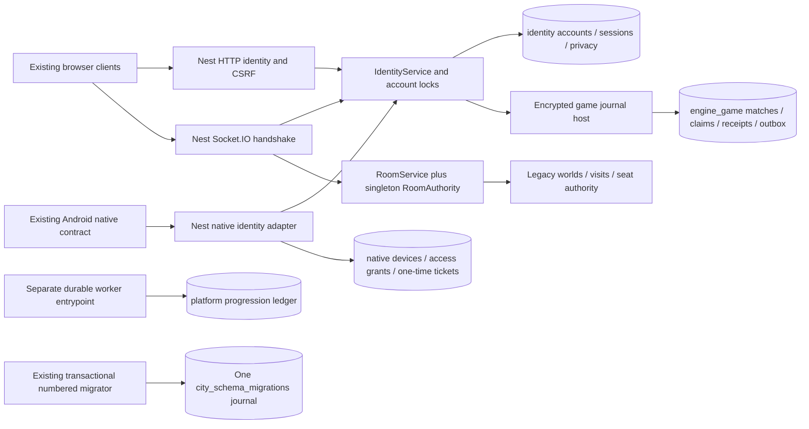

# VL-003 — Existing DB and identity integration seams

Date: 2026-11-10. This is an inventory of actual Nest/PG source, plus explicit
requirements for a future Rust adapter. It does not implement that adapter or
certify Windows authentication. Source hashes and actual disposable-PG observations
are recorded in `VL-003-DB-INVENTORY.json`; the handoff binds the committed files.

## Existing callers and DB ownership



`apps/platform-api/src/app.ts` composes the only production `new RoomAuthority`.
`worker.ts` composes the hospitality outbox and ledger, validates schema compatibility
read-only, and does not instantiate room ownership or run migrations. Existing
tables are in the deployment's configured search path; separate Rust roles/schemas
are a target, not an already-enforced privilege boundary.

## Actual identity and transport contracts

| Source | Observed contract | Rust/Windows consequence |
|---|---|---|
| `identity/service.ts` | Credential hash lookup joins active account/profile/session; checks expiry/revocation; transaction ports use canonical account locks | Preserve auth owner; revalidate current session/policy at mutation after lock waits |
| `identity/http.ts`, `app.ts` | Existing browser cookie, Origin and CSRF boundaries | No browser cookie/CSRF bypass for a new native caller; define a separate authenticated path |
| `identity/socket.ts` | Existing Socket.IO identity gateway | Not the proposed direct Rust binary WSS protocol |
| `contracts/src/native-auth.ts` | `NativeClientSchema.platform` is literal `android`; strict version/protocol offer | Windows is rejected by the current schema; do not relabel it or claim support |
| `identity/native-service.ts` | 5-minute access grants, 30-second one-use DB tickets, audience `native-socket-v1`; encrypted core credential; account-lock rechecks | Current opaque ticket is consumed by Nest, not locally verifiable by Rust; Windows/Rust trust is new VL-012/013 work |
| `identity/native-http.ts` | Existing native transport/Origin handling | No secret in a URL, embedded OAuth secret or inferred Windows deep-link allowance |
| `identity/service.ts` privacy owners | Export/deletion owner registration and account revocation notifications | New game data needs explicit privacy ownership and durable revocation synchronization |

Current notification callbacks alone are not a durable cross-service revocation
protocol. Future tickets need explicit issuer/audience/key rotation, world/content/
protocol scope, nonce replay storage, expiry, session binding and monotonic policy
generation. Reject unavailable/stale policy at the commit boundary. Do not let a
client choose account/role/authority or use a generic service token as player proof.

## Migration journal and reservation

There are exactly 47 source SQL migrations ending at `0047_game_journal.sql`.
`db/migrations.ts` computes checksums, begins a transaction, acquires
`pg_advisory_xact_lock(86732401)`, validates the existing ordered checksum prefix,
then inserts SQL and journal entries in the same transaction. Metadata version is
1; strict runtime readiness compares the complete migration manifest, not just the
largest filename. Preserve this existing Drizzle-adjacent SQL workflow.

`migration-reservations/0048.json` reserves **0048** centrally for VL-016's new
Rust game persistence. This inventory runs two real concurrent migrators against
one new disposable schema and compares every resulting journal row/checksum with
source. It creates no 0048 SQL. The production journal is neither inspected nor
modified. Before authoring/executing DDL, recheck source and target journal under
the existing lock; a conflicting 0048 requires coordination. Rust must never run
its own SQLx migrator or grant itself schema ownership.

## Durable game and reward seams

`0047_game_journal.sql` owns existing `engine_game_*` tables: encrypted state,
one active account claim, per-request payload fingerprint/version receipts,
result and recipient outbox. Nest journal hosts preserve current private projections
and crash recovery. Rust cannot reinterpret or overwrite this legacy data without
versioned fixtures and an approved later cutover. Private seed/hand/ciphertext never
belongs in public snapshots or operational logs.

New Rust persistence will use a separately owned game schema, one writer per match,
and one transaction for receipt/state/events/settlement proposal. Nest remains the
only writer of platform money/progression: consume a versioned authenticated event
into an idempotent inbox and platform ledger transaction. There is no existing
Rust reward consumer in `worker.ts`; existing hospitality outbox code is precedent,
not proof of game reward acceptance. Transport retries do not imply exactly-once
delivery; unique effect keys and reconciliation provide idempotent effects.

## Validation and limits

Reproduce with:

```sh
node scripts/with-test-db.mjs node --import tsx scripts/desktop-db-inventory.mjs
```

The script accepts only the repository's validated loopback test DB URL, creates a
random owned schema, migrates it, checks checksums/contracts and drops it in cleanup.
The wrapper owns/cleans its disposable Docker DB. No inherited `.env` or raw URL
is emitted. Root's fresh 23 authority/journal/crash integration cases at `659eb73`
also passed; those scoped regressions are not Windows/Rust acceptance. Future
contracts, DDL, roles, privacy handlers and reward consumers remain unimplemented.
