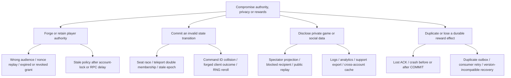

# VL-008 — Threat model and failure taxonomy

Date: 2026-11-10. Scope: new Rust native-world boundary plus preserved Nest control
plane. This is a design/test map, not a passed penetration test. Independent
security countersignature is the source-bound Agent 2 review of this task.

## Assets and trust boundaries

Protect account/session authority, privacy/consent/block policy, exclusive world/
seat/match membership, hidden cards and PRNG state, canonical receipts and currency
effects. Unity/Next/browser input is untrusted. An authenticated service still
cannot invent a player grant or write another domain's tables. Logs, replay files,
outbox, exports and spectators are separate disclosure surfaces.

## Threats, controls and required negative evidence

| ID / priority | Concrete attack or failure | Required control | Test owner / acceptance task |
|---|---|---|---|
| T01 / P0 | Replay a used grant, change audience/world/account/content, or reuse Android `native-socket-v1` at Rust | Strict versioned signature/audience/scope/expiry; atomic nonce consumption; no credential in URL/log | A2, VL-012/013: replay/wrong-key/wrong-audience/expiry/rotation matrix |
| T02 / P0 | Revoke session/block/consent while a command waits for account lock or DB/RPC | Monotonic policy generation, freshness at commit/fanout; fail closed if stale/unavailable | A2, VL-013/050: delayed command and revocation race, read and write denial |
| T03 / P0 | Two holders claim one seat or enter the same exclusive account session | Single new-world owner and durable unique claim/epoch/version; no legacy IDs in Rust | A1/A2, VL-016/019/039: simultaneous joins, stale epoch, takeover and reconnect |
| T04 / P0 | Reuse commandId with altered payload or retry a COMMIT after lost ACK | Canonical payload fingerprint, unique receipt, transactional state/events/outbox, query original receipt | A1/A2, VL-016/017/021: exact retry vs collision, real SQL waits, kill around COMMIT |
| T05 / P0 | Client supplies damage/reward/position or manipulates RNG/content versions | Semantic intents only; pure versioned integer reducers, server constraints, pinned secret RNG stream | A1, VL-015/028/044: tamper, deterministic golden replay, speed/collision/ability limits |
| T06 / P0 | Spectator/opponent sees hidden hand/seed, or block happens during fanout | Actor/viewer-specific projection after current policy check; private state encrypted at rest; scrub public replay/log/export | A2, VL-020/055: deep scan every public envelope, spectator/blocked/account-switch fixtures |
| T07 / P0 | Forged/duplicated/late reward event credits currency twice | Service-authenticated source; authoritative game finalization; unique platform inbox/effect key in ledger transaction | A2, VL-018/047: duplicate/concurrent consumer, DB crash/lost ACK, invalid source/rules/outcome |
| T08 / P0 | Teleport partially commits, disconnects or finishes after revocation | Prepare/hold/commit/abort saga; canonical location recovery; deadline/current policy; one membership | A1, VL-036/109: late preload, timeout/retry, source/target crash and mid-commit revoke |
| T09 / P1 | Oversized packet, queue flood, expensive reducer or malformed schema starves all rooms | Length/decode limits, bounded per-room mailbox, rate/admission limits, bounded CPU pool and deadlines | A1, VL-019/022/051: overflow/malformed/slow consumer, prove no accepted turn silently dropped |
| T10 / P0 | New Rust DDL/autoschema races existing migrator, role writes platform ledger, or old binary misreads new state | Single numbered checksum journal, restricted roles, versioned state/content and expand/drain rollback | A2, VL-003/016/055: conflicting journal/checksum/privilege and incompatible rollback refusal |
| T11 / P1 | Modified updater/content, exposed license/signing key or untrusted PR on GPU runner | Signed immutable manifests, hash verification, no embedded secrets, trusted self-hosted dispatch and restricted signing | A5/A7, VL-093/094/097: tamper/interruption/rollback and fork-PR isolation |

## Failure taxonomy and user-visible behavior

Authentication/policy failure: reject without mutation; safe error; reauthenticate
or refresh policy. Input/version/content mismatch: stable rejection and explicit
update/resync. Admission/backpressure: reject before acceptance with bounded retry.
Unknown durable outcome: query the same command receipt; never retry with a new ID
or invent success. DB timeout/crash: rollback or recover the committed receipt;
publish only after commit. Owner/epoch loss: stop writer/fanout and resync canonical
state. Scene/GPU loss: preserve server outcome, reconnect or safe spawn; graphics
recovery cannot create a reward. Signing/update failure: retain a qualified prior
artifact and show a truthful update failure.

## Existing evidence and gaps

Existing 23 Nest authority/journal crash/fault/persistence regressions passed in
this execution session. They exercise old ownership, encrypted projections,
receipt retries, lock waits, revocation/block races and real process death. Their
files are `tests/integration/room-owner.test.ts` and
`tests/games/{persistence,crash-recovery,fault-recovery}.integration.test.ts`.
They are reference contracts, not Rust/Unity negative-suite results.

The VL-003 disposable inventory proves the existing 47-migration lock/checksum
mechanism and rejects Windows in the current Android literal schema. New Rust
ticket, receipt, policy synchronization, role, outbox/inbox, teleport and projection
tests remain required at the tasks above. No residual P0 risk is accepted for
activation by this design record; the runtime stays disabled until those controls
and actual negative evidence pass review.
