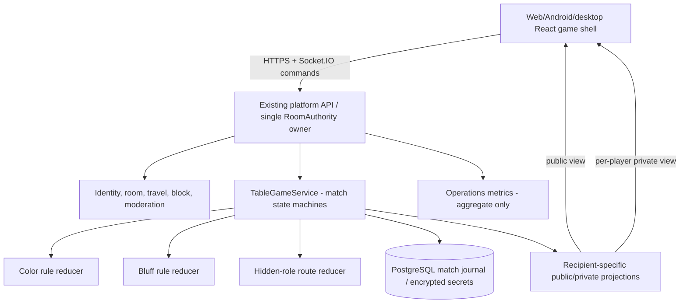

# N15–N19 — Kiến trúc Lantern Lodge / ba trò chơi bàn

**Đề xuất v2.2 (2026-11-06), plan-only; chưa triển khai.** Repo khảo sát tại `cef7dc17172f7c6cda930c99648a5e3ad609cc55`. Không thay đổi được hiểu là đã review/được duyệt cho public.

## A. Product boundary

- Một world mới: `lantern-lodge` (Hội Quán Ánh Đèn), một khu sinh hoạt 2D gốc với bảng chọn trò và nhiều bàn nhỏ. World chỉ là scene/adapter trên World SDK hiện có, **không có DB identity/session/RoomAuthority riêng**.
- Ba mode độc lập nhưng chia sẻ lifecycle: `lantern-colors` (Sắc Đèn), `mask-and-tell` (Mặt Nạ), `mistbound-routes` (Hải Đồ Sương Mù).
- `RoomAuthority` hiện có quyết định account nào được vào world/room/seat, current membership, block, safety và travel. `TableGameService` quyết định seat trong **ván/bàn**, turn/phase/hand/role/score. Một người không được tham gia hai match đang hoạt động đồng thời. Không suy từ avatar/appearance/staff role ra game quyền.
- **MVP room/table binding:** một bàn (và tối đa một ván ACTIVE) gắn với **một room cụ thể** của world `lantern-lodge`; room này vẫn do RoomService/RoomAuthority sở hữu. Room capacity của world dự kiến 8; bàn Sắc Đèn/Mặt Nạ tối đa 6, Hải Đồ tối đa 8. Room occupancy bao gồm cả người đã vào room nhưng chưa Join table: số chỗ có thể nhận thực tế = min(chỗ room còn, chỗ table còn). Trình duyệt game directory trả về `roomId` cụ thể, không dùng join theo `worldSlug` không chỉ định phòng để đảm bảo vào đúng bàn. Khi user vào nhầm room, phải chuyển qua travel/admission hiện có hoặc thông báo rõ, tuyệt đối không tự cấp quyền bàn từ room presence. Số room/world hiện hành tối đa 32; không giả định có thể chứa vô hạn bàn cùng lúc.
- **Spectator mặc định OFF trong MVP** vì khán giả cũng tiêu tốn room occupancy; chỉ mở sau khi có policy chỗ riêng, projection redaction và load tests. Không tự cho 8 người chơi + 8 người xem vào room cap 8. Hosted table không tự động kick room member hoặc ép travel để nhường chỗ.
- MVP: người chơi web, tương thích touch Android ngay từ thiết kế; shared client có thể tái sử dụng cho desktop/Steam sau này. Không thêm engine 3D, TCP/UDP khác hoặc runtime microservice chỉ để có trò bài.

## B. Context map



Dependency direction: app composes modules; `packages/boardgame-core` contains **pure deterministic rule reducers** (no DB/network/clock/system RNG), `packages/game-client` renders the approved player projection, `packages/contracts` holds versioned public and private DTOs, `apps/platform-api/src/games/` provides authority/persistence/broadcast. `packages/lantern-lodge-world` contains original scene metadata/geometry/art/entry points. Follow current boundaries guard; do not add an app-to-app import.

## C. Match lifecycle

`LOBBY -> READY_CHECK -> DEALING -> ACTIVE -> SETTLING -> FINISHED`.

Exceptions: `ABORTED` by safety/owner/eligibility or insufficient participants; `INTERRUPTED` if owner restart/lock loss. A persisted match is not automatically declared finished after a restart. It must be recovered under tested rules, otherwise aborted with truthful message and no reward. Stable `rulesetVersion`, `gameMode`, table limit, participants and initial shuffle commitment are fixed at DEALING.

Host creates lobby; each invitee explicitly chooses Join/Ready. Host cannot unilaterally force an account into a game. Public table activity reports people playing only if current privacy policy allows; never expose hands, roles, hidden routes, unchallenged cards, or hidden goal via presence/world catalog. Spectators are disabled in MVP; future approved spectators get only **sanitized** projection and a separate capacity policy, with no right to peek just because they are admin, host or friend.

Before accepting a command: verify server session, current room epoch/membership, table participant seat, active match generation, turn/phase ownership, server deadline, policy/block/ban, rate limit, expected version, and idempotency key. A command must not select a different accountId, role, game owner or private target from a client-supplied field.

## D. Authority / persistence

- All accepted gameplay mutation is serialized **per match**, with a PostgreSQL transaction protecting `stateVersion` and a unique `(matchId, accountId, requestId)` receipt. One accepted mutation yields one committed result. The current RoomAuthority singleton remains the ingress/fencing guard; game DB transactions do not pretend to implement multi-replica room routing. Every awaited external read is followed by **fresh authority/session/room epoch/phase/deadline checks before committing**, or the command fails closed; do not hold a global RoomService queue across unbounded DB work.
- One-account/one-active-table is enforced durably with a dedicated unique `game_active_claims(account_id PRIMARY KEY,match_id,generation,...)` reservation, allocated/released transactionally with match terminal transitions. In-memory checking is insufficient for concurrent tabs and restart. The logical table seat never grants world admission, and `room.join` does not automatically grant a table seat. Capacity races and partial admission failures must release unused claims safely.
- Turn-based traffic is low enough to persist **each accepted turn/phase** at MVP; no reason to keep all hidden secrets only in RAM. A volatile read cache is optional after measurement. Persist private hand/role/deck/treasure information encrypted under a separate key, never in public JSON or generic logs. On missing key fail closed; backup/restore drills must include key custody outside Git.
- Suggested additive schema (finalize after audit/ADR): `game_matches` (mode, ruleset_version, status, state_version, opaque encrypted state, authoritative deadline, room epoch, timestamps), `game_participants` (match/account/seat/consents), `game_active_claims` (account PK, match/generation/lease), `game_command_receipts` (request id, sanitized outcome/version), `game_results` (unique match settlement), `game_notification_outbox` (recipient-scoped publish). Do not store raw full card hand in command receipt or metrics. Existing world room state remains in RoomService rather than being cloned into SQL; after owner restart, rebind to a new *authorized* room membership or terminate truthfully. An `INTERRUPTED` match is not silently resumed across a new owner epoch.
- Use server CSPRNG to seed deterministic shuffle/role allocation once, record `seedCommitment = SHA256(seed || matchId || rulesetVersion)` and encrypted seed/state. Optional seed reveal **after match ends only**, with documented privacy/security review; MVP does not require exposing the seed publicly. Reducers accept injected seed/random stream for reproducible property tests.
- Outbox sends only after durable commit, at-least-once delivery may duplicate; clients dedupe by `matchId`/`version`. Reconnect fetches authorized fresh projection; stale delayed responses must not rewrite newer version or old identity.
- Deadlines use authoritative UTC instants + per-phase nonce/version. After restart a recovery worker processes overdue phases under the same match transaction, **at most once effective transition**. Do not use client timers as authority or make uncontrolled timeout bots impersonate players.

## E. Transport / projections

Command envelope example (not frozen API):

```json
{"protocolVersion":1,"matchId":"opaque-id","requestId":"uuid","expectedVersion":17,"kind":"color.play","payload":{"cardId":"opaque-card-id","spendGlow":false}}
```

ACK: `requestId`, `status=ACCEPTED|REJECTED`, `errorCode`, `serverVersion`, `serverTime`, `turnDeadline`, plus only the requesting player's authorized view. Public view events can go through `game.delta`; private hand/role is emitted only to the *authenticated recipient socket/session* or read through recipient-scoped authenticated HTTP. Do **not** broadcast private data to an ordinary Socket.IO room, even if all members are friends. Spectator projection must be independently tested.

Canonical denial codes: `AUTH_REQUIRED`, `NOT_IN_ROOM`, `NOT_PARTICIPANT`, `GAME_FULL`, `TABLE_CLOSED`, `WRONG_TURN`, `WRONG_PHASE`, `INVALID_CARD`, `INVALID_PLACEMENT`, `DEADLINE_EXPIRED`, `STATE_CONFLICT`, `RATE_LIMITED`, `WORLD_DISABLED`, `OWNER_UNAVAILABLE`, `UNAVAILABLE`. Ambiguous committed replies are reconciled by same requestId; arbitrary retry with a new key may be rejected as stale.

## F. UI ownership

Render table, deck and public game board with DOM/React or lightweight Pixi scenes, but **private hands and action controls must have semantic DOM equivalents** for keyboard, screen reader, high-contrast and touch. Color is never the sole indicator: each card has suit glyph, number/action label and accessible name. Touch targets >=44×44 CSS px as design goal; preserve reduced-motion setting, focus restoration and safe-area handling. Display *your turn*, current action, timeout, private hand, friends, disconnection, lobby-full and Match Interrupted as explicit states. Never animate an action as committed before server ACK; optimistic hover/drag is cosmetic only.

## G. Safety, content, retention and fairness

Existing block/report/moderation applies before table invitation and public communication. MVP uses the existing safe quick-message catalogue, emotes and reporting; unrestricted chat/DM/audio is not enabled by a mini-game. Leave/Travel/Block/Ban can terminate participation; no private card/role leaks in notifications, moderation receipts, recordings or admin exports. Hidden-role games generate competitive disagreement: include non-harassment copy, private reporting and easy Leave; no punishment of real accounts based on roleplay bluffing.

No real-money stake, paid random reward, gun/Russian-roulette mechanics, licensed Party Animals art/sound/text/character/trademarks. Mechanic inspiration is permissible to explore, but legal/content rights review remains a separate gate. Create original naming/graphics/rules text; retain asset provenance and consent evidence. Existing progression stays OFF by default; optional non-monetary participation stats cannot reward spam or repeat short matches without an abuse policy.

Proposed retention requires privacy review: active-match state until settlement, sanitized personal history for up to 30 days initially, command receipts bounded (e.g. 7 days) and restricted abuse evidence only under existing safety policy. These are **proposals**, not approved legal retention.

## H. Performance and scaling

The first release stays with existing single RoomAuthority owner; no Redis distributed games cluster by default. Instrument match turn processing, DB time, private view fanout, reconnect latency, active tables, timeout rate, cancellations and unexpected errors. Metrics have fixed `mode/status` labels, **never card IDs, hands, room IDs, usernames, chat text, roles or target exit IDs**. `games_active`, `game_command_latency`, `game_turn_timeouts`, `game_reconnects`, `game_settlement_errors` are candidates.

Provisional *targets to validate on actual server* (not measured promises): zero accepted illegal actions/hidden leaks/duplicate results; turn ACK p95 <=500ms under defined healthy profile; match recovery <=10s after compatible owner restart or a truthful abort; Android 30fps+ during board interactions on the one reported device; UI action targets >=44px. Load experiments must describe client count, tables, host, hardware, rejection counts, latencies and profile; 1,000 sockets from old tests are not 1,000 playing board-game clients.

## I. Release / feature flags

Separate `gameLodge.enabled`, `games.lanternColors.enabled`, `games.maskAndTell.enabled`, `games.mistboundRoutes.enabled`, and `games.spectate.enabled`; all default OFF / production fail closed until approved. Stage in order Sắc Đèn -> Mặt Nạ -> Hải Đồ; deploy backend + contract compatibility safely before exposing UI flags. During release, owner drain blocks new table starts; running matches either complete under compatible old owner, resume from persisted state after re-admission, or explicitly abort per tested policy. Argo rollback of an image never implies reversing DB migrations.
