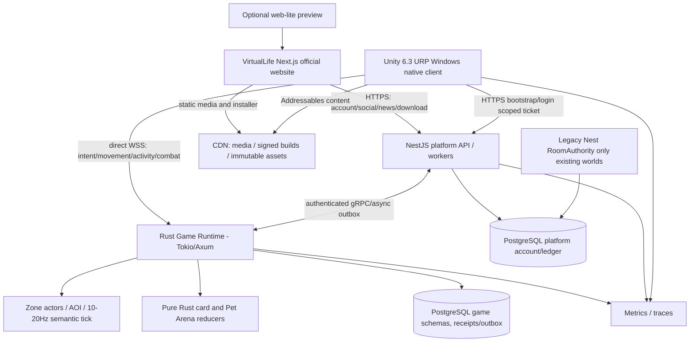

# System topology — desktop game + official website + Rust data plane

Only one authoritative game owner per world ID: legacy Nest for legacy worlds until G7 cutover; Rust for new `Aurora` worlds and new games. Website never routes movement ticks through Next/Nest. No client can mutate database or wallet directly. Native installer/patch signing handled by restricted CI and CDN, not game server.
