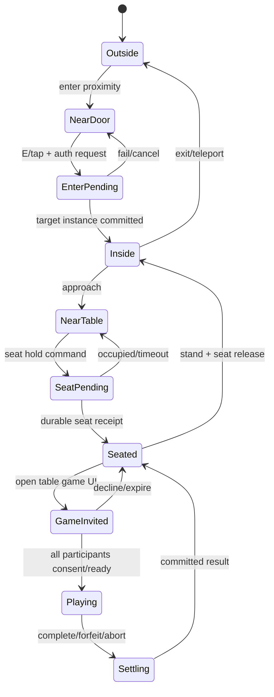

# Interaction states — walk, enter, seat, play, leave

## Principle
**Walking is free until a server-validated commitment.** Game rules only gate committed table/game activity; UI can always show action/cancel/forfeit choices. No teleporting while still claiming reward in paused match.

## Venue/table FSM

## Concrete state owner and transitions
- `InteractNearDoor`: client gives object GUID + intended action; Rust independently calculates actual distance/line of sight, zone membership, safety rule, capacity. No client claimed distance.
- `SeatHold`: target seat authority, unique `(roomInstanceId, tableId, seatId)`, TTL + epoch, exclusive CAS; if crowd race winner obtains receipt, others see available updated list.
- `Sit`: animation starts on accepted server response, chair anchor/height/IK; late ACK safe and seat view shown pending.
- `JoinActivity`: server validates seated position, game active participants/spectators policies, same authoritative owner. Public world character can continue idle/social expressions while overlay game is active; movement controls restricted with explanatory UX.
- `LeaveGame`: `abandon` or `forfeit` with consent; settled match receipt and seat release policy; network drop timeout policy explicit; no silent loss of match on tab switch unless rule specifies.
- `LeaveVenue`: no removal until source role/target travel commit; regain room owner authoritative seat clean-up by idempotent command.

## Maid Café / café service
Food ordering is a persistent business flow owned by platform ledger/order module; world visuals (hold tray, serve coffee, seat gestures) cannot independently grant balance/item or mark order fulfilled. Rust `servicePerformed` event may propose action; Nest validates order lifecycle and commits receipt. If worker stalls show `order pending` without fabricated success. SFW roleplay, no unsolicited intimate interactions.

## Interactable affordances
Outline highlight, reachable icon, `E` or gamepad X, mobile tap; focus hint only within distance; tooltips include `đang có người`, `cần hoàn thành trận`, `đã khóa riêng tư`. Continuous navigation never opened through modal without visual route/fast travel rationale.

## Error/recovery
Socket loss while seated: seat TTL and game pause grace; transient reconnect retains authenticated claims; explicit logout/revocation releases after reconciler; crash recovery replays semantic seat ownership, expires holds, sends canonical projection. Test double seat, duplicate ACK, race teleport/stand, cross-room block.
