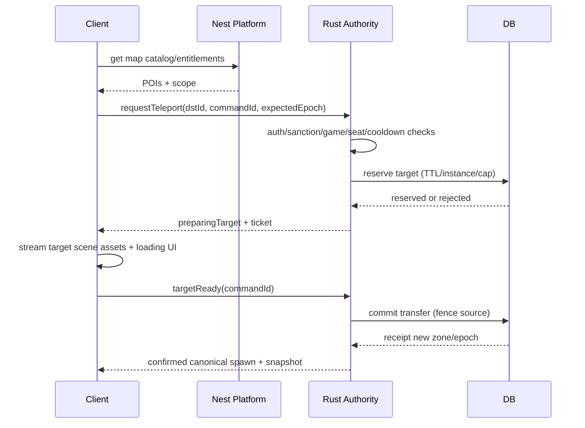

# Map `M`, discovery and fast travel — spec v1

## UX
- Desktop: press **M** to toggle full-screen/semi-transparent world map; second M/Esc closes. Dedicated button on HUD; controller Menu/Map; mobile map icon. Do not intercept keyboard when focus in chat/input/modal.
- Map layers: **City** → District → Building/Indoor floor; `search POI` autocomplete; filters Café / Game / Arena / Social / Events / Travel / Friends (only opted-in share).
- Each place card: image/concept preview, name, description, accessible status, queue/capacity (grounded real-time if available), travel cost/cooldown, `Đi bộ`, `Dịch chuyển`, `Dẫn đường`.
- Offline/mock mode: map still accessible with disabled buttons and truthful state; don't fabricate vacancy/open-now.

## Teleport rules
- Access control: authenticated, same account membership, destination unlocked, admission/capacity, parent/age policy, party privacy, event restrictions, active match/seat policy, per-account cooldown, rate limiting, legitimate source location if walk-only.
- Two-phase **target reservation then commit source release** with durable saga/epoch/nonce; no DB distributed transaction across separate authorities assumed. On failure preserve old location or known safe spawn, never both active.
- Teleport target may be outside city (island, festival, Lodge, Pet dungeon) but all are registered `destination_id` in a versioned catalog; player cannot send arbitrary coordinates.
- Party travel leader request requires each member's independent consent/eligibility; capacity preflight prevents partial teleport surprises, with explicit partial failure UX.
- Teleport to player only on permission, visibility policy and safety; never expose raw private locations on general map.

## Control flow

Actual source/target owner cross-process protocol needs tested fencing/saga, especially legacy Nest RoomAuthority; until migration use cross-owner adapter and avoid split-brain.

## Visual/readability
Daylight mint-blue district map, path overlay, teleport node as glowing star ring, active destination bold, minimap corners, icon+label not only color; mobile touch targets ≥44px; keyboard focus cycle; accessible list view. Use `07-visuals/VirtualLife-city-map.svg` for example POI layout and `VirtualLife-ui-prototype.html` for UX proof-of-concept.

## Metrics/tests
POI discoverability, M hotkey latency, access denied clarity, teleport p95 completion excluding asset download, cancel/resume, memory spikes between interiors, stale members, rate limit, event over-capacity, block/revoke mid-transfer, duplicate requestId, lost ACK. Teleport result is server receipt, not scene fade end.
