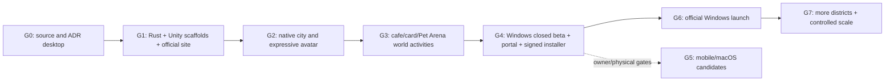

# VirtualLife v1.1 task DAG summary

- **G0: 14 tasks**
- **G1: 18 tasks**
- **G2: 17 tasks**
- **G3: 21 tasks**
- **G4: 18 tasks**
- **G5: 8 tasks**
- **G6: 7 tasks**
- **G7: 7 tasks**

**Critical local path example:** `VL-001 → VL-002 → VL-077/078 → VL-080 → VL-082/081 → VL-027/085 → VL-087 → VL-095 → VL-099 → VL-102 → VL-070` (not the only path; Rust turn and venue/card/Pet dependencies must also pass).

Use `python3 tools/next_task.py` for **actual** ready tasks once real evidence has been recorded. Task states are all `TODO` as shipped, not automatically completed by document generation.
