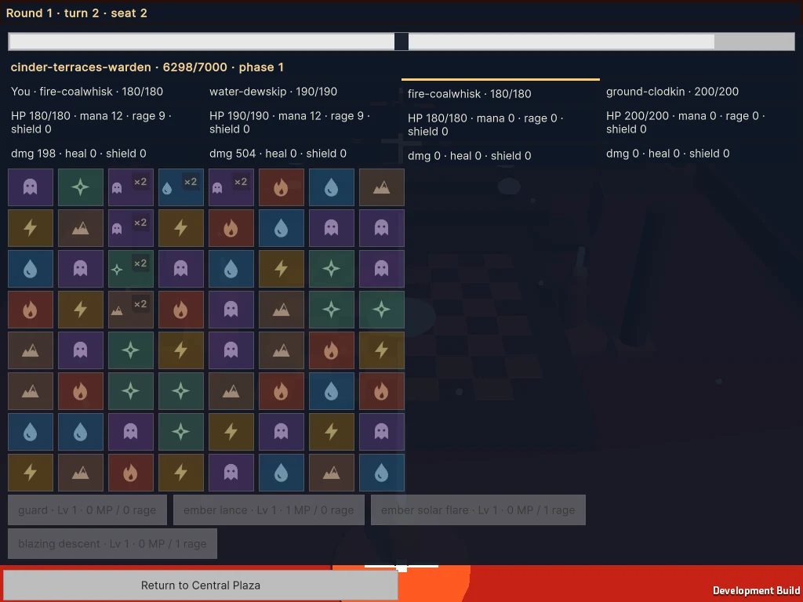

# Wave D4 production acceptance

The canonical backlog is [development-plan.json](../../config/development-plan.json). Each row identifies the revision on which its evidence was observed. A pending row needs a new run or the named decision. Technical, visual and owner acceptance are recorded separately.

## Evidence sources

| Source | Reproducible or retained evidence |
| --- | --- |
| Player / Native | Local evidence under `artifacts/wave-d4-session/{integrated-packaged-coop.json,integrated-native-verified.log}` |
| Admin | `artifacts/wave-d4-session/admin-skill-publication.json` |
| Balance / Performance | `artifacts/wave-d4-measures/{balance-summary.json,performance-summary.json}` |
| Character | `artifacts/wave-d4-art/icarus-H1-R3/gates/H1/` |
| Media / Local stage receipt | `artifacts/wave-d4-media/{original-score-r1,opening-animatic-r2,private-art-stage-receipt-r2.json}` |
| Gemini workflow | [Production inputs and prompt handoffs](../media/gemini-production.md) |
| Gallery | [Guest and equipment](../../assets/review/wave-d4/baseline/), [combat](../../assets/review/wave-d4/combat/), [six maps](../../assets/review/wave-d4/world/) |

Both combat frames use the same 1024×768 reconnect scenario with different match seeds. The newer capture shows six shapes and visible ×2 badges. An earlier 800×500 test exposed an 11-pixel collision for ×64. After adjusting multiplied glyphs, the same assertion passed on 85c85729. Direct Editor tests returned 79 EditMode and 36 PlayMode passes, with two explicit service skips.

## Integration and repository

Related tasks VL-199, VL-203.

| ID | Acceptance condition | State | Revision and evidence | Finding or remaining work |
| --- | --- | --- | --- | --- |
| A01 | PR88 integrated through protected green workflow. | IN_PROGRESS | eb980abb · integration branch | Combined locally. Protected merge and hosted revision require confirmation. |
| A02 | PR89 integrated through protected green workflow. | IN_PROGRESS | eb980abb · integration branch | Combined locally. Protected merge and hosted revision require confirmation. |
| A03 | Required Rust checks pass. | IN_PROGRESS | 68584413 · native and legacy suites | Scoped local evidence and earlier protected CI exist. Full hosted suite on the new source is pending. |
| A04 | Required TypeScript and database integration checks pass. | IN_PROGRESS | 68584413 · native and legacy suites | Scoped local evidence and earlier protected CI exist. Full hosted suite on the new source is pending. |
| A05 | Governance, harness and browser checks pass. | IN_PROGRESS | 68584413 · native and legacy suites | Scoped local evidence and earlier protected CI exist. Full hosted suite on the new source is pending. |
| A06 | Historical migration compatibility preserved. | IN_PROGRESS | 68584413 · native and legacy suites | Scoped local evidence and earlier protected CI exist. Full hosted suite on the new source is pending. |
| A07 | Canonical backlog and execution checkpoints updated. | IN_PROGRESS | eb980abb · canonical plan | Keep verified states tied to exact revisions and hosted checks. |

## Playable game

Related tasks VL-199, VL-209, VL-210.

| ID | Acceptance condition | State | Revision and evidence | Finding or remaining work |
| --- | --- | --- | --- | --- |
| B01 | Clean committed-source Unity build produced. | PASS | 68584413 · Player | One Linux guest, three socket clients, Fire victory v29, four receipts and Water admission with Lv2 Core. Restart preserved v3 and all 64 tiles. |
| B02 | Normal guest login works. | PASS | 68584413 · Player | One Linux guest, three socket clients, Fire victory v29, four receipts and Water admission with Lv2 Core. Restart preserved v3 and all 64 tiles. |
| B03 | Central Plaza navigation works. | PASS | 68584413 · Player | One Linux guest, three socket clients, Fire victory v29, four receipts and Water admission with Lv2 Core. Restart preserved v3 and all 64 tiles. |
| B04 | Pet collection and owned selection work. | PASS | 68584413 · Player | One Linux guest, three socket clients, Fire victory v29, four receipts and Water admission with Lv2 Core. Restart preserved v3 and all 64 tiles. |
| B05 | Equipment and Skill Training work. | IN_PROGRESS | b1472300 · progression and settlement tests | Core and earned materials exercised. Full packaged natural-training and acquisition coverage pending. |
| B06 | Regular encounters work through normal navigation. | NOT_RUN | — | Collect dedicated evidence for this condition. |
| B07 | Cooperative room creation and joining work. | PASS | 68584413 · Player | One Linux guest, three socket clients, Fire victory v29, four receipts and Water admission with Lv2 Core. Restart preserved v3 and all 64 tiles. |
| B08 | Four independently authenticated seats share one match. | PASS | 68584413 · Player | One Linux guest, three socket clients, Fire victory v29, four receipts and Water admission with Lv2 Core. Restart preserved v3 and all 64 tiles. |
| B09 | Legal combat reaches a victory. | PASS | 68584413 · Player | One Linux guest, three socket clients, Fire victory v29, four receipts and Water admission with Lv2 Core. Restart preserved v3 and all 64 tiles. |
| B10 | Legitimate rewards settle exactly once. | PASS | 68584413 · Player | One Linux guest, three socket clients, Fire victory v29, four receipts and Water admission with Lv2 Core. Restart preserved v3 and all 64 tiles. |
| B11 | Progression changes the next authoritative allocation. | PASS | 68584413 · Player | One Linux guest, three socket clients, Fire victory v29, four receipts and Water admission with Lv2 Core. Restart preserved v3 and all 64 tiles. |
| B12 | Return to hub and next encounter work. | PASS | 68584413 · Player | One Linux guest, three socket clients, Fire victory v29, four receipts and Water admission with Lv2 Core. Restart preserved v3 and all 64 tiles. |
| B13 | Disconnect and runtime restart preserve committed state. | PASS | 68584413 · Player | One Linux guest, three socket clients, Fire victory v29, four receipts and Water admission with Lv2 Core. Restart preserved v3 and all 64 tiles. |
| B14 | Fixture-assisted and natural progression evidence are distinguished. | PASS | 68584413 · Player | One Linux guest, three socket clients, Fire victory v29, four receipts and Water admission with Lv2 Core. Restart preserved v3 and all 64 tiles. |

## Combat and balance

Related tasks VL-211.

| ID | Acceptance condition | State | Revision and evidence | Finding or remaining work |
| --- | --- | --- | --- | --- |
| C01 | All 55 active Pets pass applicable combat conformance. | PASS | aa730cc2 · catalog_conformance | 55 Lv1 kits executed 221 abilities across 11 effect families with fixture resources. |
| C02 | All 221 abilities retain Lv1 access. | PASS | aa730cc2 · catalog_conformance | 55 Lv1 kits executed 221 abilities across 11 effect families with fixture resources. |
| C03 | All eleven supported effects have behavioral coverage. | PASS | aa730cc2 · catalog_conformance | 55 Lv1 kits executed 221 abilities across 11 effect families with fixture resources. |
| C04 | Icarus-only FIRE_ZONE preserved. | PASS | aa730cc2 · catalog_conformance | 55 Lv1 kits executed 221 abilities across 11 effect families with fixture resources. |
| C05 | Six elements have meaningful strategic identity. | NOT_RUN | — | Collect dedicated evidence for this condition. |
| C06 | Board initialization failure is reproduced and resolved. | PASS | eb980abb · Balance | Seed 114 retained. Constructive opening resolves it; lower-pressure and shared-pressure have distinct holdout outcomes. |
| C07 | Boss transformation and multiplier behavior verified. | PASS | 68584413 · Player | Phase 2 at v25. Five multiplier tiles retained on recovery. |
| C08 | Early and intermediate progression evaluated. | IN_PROGRESS | eb980abb · Balance | 2,304 simulations across six Bosses. Natural access to tested Lv20 and gear remains open. |
| C09 | At least two meaningful balance candidates compared. | PASS | eb980abb · Balance | Seed 114 retained. Constructive opening resolves it; lower-pressure and shared-pressure have distinct holdout outcomes. |
| C10 | Separate confirmation seed results recorded. | PASS | eb980abb · Balance | Seed 114 retained. Constructive opening resolves it; lower-pressure and shared-pressure have distinct holdout outcomes. |
| C11 | Six Bosses evaluated with attainable teams. | IN_PROGRESS | eb980abb · Balance | 2,304 simulations across six Bosses. Natural access to tested Lv20 and gear remains open. |
| C12 | Owner balance approval recorded separately. | OWNER_REVIEW_REQUIRED | eb980abb · Balance | Owner selects or rejects the candidate digest. |

## Progression and economy

Related tasks VL-207, VL-208.

| ID | Acceptance condition | State | Revision and evidence | Finding or remaining work |
| --- | --- | --- | --- | --- |
| D01 | Every skill has explicit trainable or fixed policy. | PASS | 6aa4a64a · skill-training-candidate.mjs | Unpublished candidate defines 164 trainable and 57 fixed skills. |
| D02 | Skill upgrade costs and scaling have authoritative semantics. | IN_PROGRESS | b2a35703 · Admin | Browser-published Tide Lance Lv2 at 17 materials and 1150‰ in disposable PostgreSQL. Complete Artifact domain acceptance. |
| D03 | Core, Aegis and Rune binding verified. | IN_PROGRESS | b1472300 · progression and settlement tests | Core and earned materials exercised. Full packaged natural-training and acquisition coverage pending. |
| D04 | Earned Artifact acquisition and equipment verified. | IN_PROGRESS | b1472300 · progression and settlement tests | Core and earned materials exercised. Full packaged natural-training and acquisition coverage pending. |
| D05 | Skill and Artifact changes preserve active-match immutability. | IN_PROGRESS | b1472300 · progression and settlement tests | Core and earned materials exercised. Full packaged natural-training and acquisition coverage pending. |
| D06 | Natural guest progression evidence recorded. | PASS | b1472300 · progression tests | Natural guest first clear and starter wallet repair verified independently from packaged fixtures. |
| D07 | Achievement Point eligibility and abuse resistance verified. | IN_PROGRESS | b1472300 · progression and settlement tests | Core and earned materials exercised. Full packaged natural-training and acquisition coverage pending. |
| D08 | Recruitment works for both encounter completion orders. | PASS | 76394de5 · coop-settlement.test.ts | Both encounter orders exercised over six maps using terminal proposals. |
| D09 | Acquisition and rarity rules remain canonical. | NOT_RUN | — | Collect dedicated evidence for this condition. |
| D10 | Six gated candidates remain gated. | PASS | eb980abb · conformance | 55 active and six disabled candidates. |

## Unity visual quality

Related tasks VL-179, VL-210.

| ID | Acceptance condition | State | Revision and evidence | Finding or remaining work |
| --- | --- | --- | --- | --- |
| E01 | Actual pre-change baseline screenshots captured. | IN_PROGRESS | 663de837 · Gallery | Baseline 1024×768 captures. Still need complete screens and matched after views. |
| E02 | Main menu visual improvement demonstrated. | NOT_RUN | — | Collect dedicated evidence for this condition. |
| E03 | Central Plaza visual improvement demonstrated. | NOT_RUN | — | Collect dedicated evidence for this condition. |
| E04 | Pet collection and detail presentation improved. | NOT_RUN | — | Collect dedicated evidence for this condition. |
| E05 | Equipment and Skill Training visual quality improved. | NOT_RUN | — | Collect dedicated evidence for this condition. |
| E06 | Campaign and lobby presentation improved. | NOT_RUN | — | Collect dedicated evidence for this condition. |
| E07 | Combat board readability and visual quality improved. | IN_PROGRESS | e19170e5 · ElementTiles | Six shapes separate from corner multiplier badges in the Linux capture. Disabled-seat contrast, use of screen width and scroll-dependent actions need review. |
| E08 | Six elemental tiles are visually distinguishable. | PASS | d032a3b9 · rendered Linux comparison | Flame, droplet, bolt, ghost, mountain and star silhouettes are visible in the retained reconnect frame. |
| E09 | Active turn and resource state remain readable. | IN_PROGRESS | 663de837 · Gallery | Baseline 1024×768 captures. Still need complete screens and matched after views. |
| E10 | Cascades and multiplier effects are visually satisfying. | NOT_RUN | — | Collect dedicated evidence for this condition. |
| E11 | Skill, damage, healing and shield feedback works. | NOT_RUN | — | Collect dedicated evidence for this condition. |
| E12 | Boss transformation presentation works. | NOT_RUN | — | Collect dedicated evidence for this condition. |
| E13 | Victory and reward presentation works. | IN_PROGRESS | 663de837 · Gallery | Baseline 1024×768 captures. Still need complete screens and matched after views. |
| E14 | Reduced motion and flash controls verified. | NOT_RUN | — | Collect dedicated evidence for this condition. |
| E15 | 1080p and 720p layouts inspected. | NOT_RUN | — | Collect dedicated evidence for this condition. |
| E16 | Compact window layout inspected. | NOT_RUN | — | Collect dedicated evidence for this condition. |
| E17 | Before-and-after gameplay evidence published within permitted scope. | IN_PROGRESS | 663de837 · Gallery | Baseline 1024×768 captures. Still need complete screens and matched after views. |
| E18 | Remaining visual defects explicitly recorded. | PASS | 663de837 · Gallery | Tile labels collided, board used half the window, actions required scrolling. Dawn highlights clip. |

## Character production

Related tasks VL-204, VL-205.

| ID | Acceptance condition | State | Revision and evidence | Finding or remaining work |
| --- | --- | --- | --- | --- |
| F01 | Owner reference inventory and hashes verified. | NOT_RUN | — | Collect dedicated evidence for this condition. |
| F02 | Icarus face and hair review package prepared. | PASS | 89db72d3 · Character | H1 R3 face and expression views retained. Five independent Blender controls. Separate blink preview. |
| F03 | Icarus facial deformation evidence produced. | PASS | 89db72d3 · Character | H1 R3 face and expression views retained. Five independent Blender controls. Separate blink preview. |
| F04 | Icarus modular costume and accessories inspected. | NOT_RUN | — | Collect dedicated evidence for this condition. |
| F05 | Icarus wing articulation and bow attachment verified where permitted. | NOT_RUN | — | Collect dedicated evidence for this condition. |
| F06 | Actual model geometry and material budgets measured. | NOT_RUN | — | Collect dedicated evidence for this condition. |
| F07 | Actual rig and animation evidence produced where permitted. | NOT_RUN | — | Collect dedicated evidence for this condition. |
| F08 | Representative starter Pet production advanced. | IN_PROGRESS | 89db72d3 · Character | Morphology references and two identity concepts exist. Production models pending. |
| F09 | Representative Dragon and Bird production advanced. | IN_PROGRESS | 89db72d3 · Character | Morphology references and two identity concepts exist. Production models pending. |
| F10 | Actual Unity model renders captured. | NOT_RUN | — | Collect dedicated evidence for this condition. |
| F11 | Production readiness updated per actual asset stage. | PASS | eb980abb · canonical plan | Accepted production model count 0/55. H1 undecided; later gates require separate decisions. |
| F12 | H1-H4 owner approvals remain separate and accurate. | PASS | eb980abb · canonical plan | Accepted production model count 0/55. H1 undecided; later gates require separate decisions. |

## World and environment

Related tasks VL-188, VL-206.

| ID | Acceptance condition | State | Revision and evidence | Finding or remaining work |
| --- | --- | --- | --- | --- |
| G01 | Central Plaza world composition reviewed. | PASS | c6276c4c · Gallery | Visually reviewed development scenes; overbright Dawn and repeated primitive composition need improvement. |
| G02 | Cinder Terraces playable scene verified. | PASS | c6276c4c · Gallery | Local build receipt and actual six-map world route; 64 tiles per arena and round-trip portals. |
| G03 | Tideglass Lagoon playable scene verified. | PASS | c6276c4c · Gallery | Local build receipt and actual six-map world route; 64 tiles per arena and round-trip portals. |
| G04 | Stormcoil Fields playable scene verified. | PASS | c6276c4c · Gallery | Local build receipt and actual six-map world route; 64 tiles per arena and round-trip portals. |
| G05 | Lantern Necropolis playable scene verified. | PASS | c6276c4c · Gallery | Local build receipt and actual six-map world route; 64 tiles per arena and round-trip portals. |
| G06 | Ochre Labyrinth playable scene verified. | PASS | c6276c4c · Gallery | Local build receipt and actual six-map world route; 64 tiles per arena and round-trip portals. |
| G07 | Dawn Prism Sanctum playable scene verified. | PASS | c6276c4c · Gallery | Local build receipt and actual six-map world route; 64 tiles per arena and round-trip portals. |
| G08 | Six regular encounter paths verified. | IN_PROGRESS | 76394de5 · coop-settlement.test.ts | Six-map persistence with fixture terminals. Natural six-map game journey remains open. |
| G09 | Six cooperative Boss encounter paths verified. | IN_PROGRESS | 76394de5 · coop-settlement.test.ts | Six-map persistence with fixture terminals. Natural six-map game journey remains open. |
| G10 | Portal and campaign progression verified. | IN_PROGRESS | 76394de5 · coop-settlement.test.ts | Six-map persistence with fixture terminals. Natural six-map game journey remains open. |
| G11 | Environment lighting and composition visually reviewed. | PASS | c6276c4c · Gallery | Visually reviewed development scenes; overbright Dawn and repeated primitive composition need improvement. |
| G12 | Actual in-game map screenshots available. | PASS | c6276c4c · Gallery | Visually reviewed development scenes; overbright Dawn and repeated primitive composition need improvement. |

## Gemini cinematic and music production

Related tasks VL-184, VL-187.

| ID | Acceptance condition | State | Revision and evidence | Finding or remaining work |
| --- | --- | --- | --- | --- |
| H01 | Actual Gemini session capability inspected. | PASS | 3d23e0be · Gemini workflow | Authenticated tab exposed Create image, video and music. Tideglass brief submitted; output retrieval is unverified. |
| H02 | Authorized generation workflow established. | PASS | 3d23e0be · Gemini workflow | Authenticated tab exposed Create image, video and music. Tideglass brief submitted; output retrieval is unverified. |
| H03 | Opening cinematic candidate produced. | IN_PROGRESS | 8df1f478 · Media | 25.6 s, 720p, 30 fps local animatic. Final title remains legible against the dimmed Dawn shot. Rig animation, final cinematic and rights review remain open. |
| H04 | Icarus introduction candidate produced where references are authorized. | NOT_RUN | — | Collect dedicated evidence for this condition. |
| H05 | Icarus skill showcase candidate produced. | NOT_RUN | — | Collect dedicated evidence for this condition. |
| H06 | Fire cinematic candidate produced. | NOT_RUN | — | Collect dedicated evidence for this condition. |
| H07 | Water cinematic candidate produced. | NOT_RUN | — | Collect dedicated evidence for this condition. |
| H08 | Main theme candidate produced. | PASS | d1435d44 · Media | Local original eight-cue audition includes WAV masters and Ogg derivatives. |
| H09 | Central Plaza music or ambience produced. | PASS | d1435d44 · Media | Local original eight-cue audition includes WAV masters and Ogg derivatives. |
| H10 | Exploration music candidates produced. | PASS | d1435d44 · Media | Local original eight-cue audition includes WAV masters and Ogg derivatives. |
| H11 | Boss combat and Phase 2 music candidates produced. | PASS | d1435d44 · Media | Local original eight-cue audition includes WAV masters and Ogg derivatives. |
| H12 | Victory and defeat audio candidates produced. | PASS | d1435d44 · Media | Local original eight-cue audition includes WAV masters and Ogg derivatives. |
| H13 | Visual and audio defects reviewed. | IN_PROGRESS | d1435d44 · Media | Technical audition and provenance available. Listening review, clearance and score integration pending. |
| H14 | Actual media files retained. | PASS | d1435d44 · Media | Local original eight-cue audition includes WAV masters and Ogg derivatives. |
| H15 | Technical and rights status recorded. | IN_PROGRESS | d1435d44 · Media | Technical audition and provenance available. Listening review, clearance and score integration pending. |
| H16 | Authorized media integrated into Unity. | IN_PROGRESS | d1435d44 · Media | Technical audition and provenance available. Listening review, clearance and score integration pending. |
| H17 | Cinematic skip, audio controls and transitions verified. | NOT_RUN | — | Collect dedicated evidence for this condition. |

## Performance

Related tasks VL-181, VL-213.

| ID | Acceptance condition | State | Revision and evidence | Finding or remaining work |
| --- | --- | --- | --- | --- |
| I01 | Pre-change executable performance baseline recorded. | PASS | 68584413 · Performance | Three 720p 60 Hz Gamescope runs. Mean 58.38–59.08 FPS. Whole-route p99 49.77–59.64 ms. Windows hardware qualification open. |
| I02 | Representative hardware and workload recorded. | PASS | 68584413 · Performance | Three 720p 60 Hz Gamescope runs. Mean 58.38–59.08 FPS. Whole-route p99 49.77–59.64 ms. Windows hardware qualification open. |
| I03 | Frame-time percentiles measured. | PASS | 68584413 · Performance | Three 720p 60 Hz Gamescope runs. Mean 58.38–59.08 FPS. Whole-route p99 49.77–59.64 ms. Windows hardware qualification open. |
| I04 | CPU and supported GPU metrics measured. | NOT_RUN | — | Collect dedicated evidence for this condition. |
| I05 | Draw calls, geometry and texture memory measured. | NOT_RUN | — | Collect dedicated evidence for this condition. |
| I06 | Scene and asset loading measured. | NOT_RUN | — | Collect dedicated evidence for this condition. |
| I07 | Repeated transition memory growth inspected. | IN_PROGRESS | 68584413 · Performance | Observed peak RSS 420.9–423.7 MiB in two runs. Longer soak and attribution pending. |
| I08 | Four-player combat workload measured. | NOT_RUN | — | Collect dedicated evidence for this condition. |
| I09 | Boss transformation and VFX workload measured. | NOT_RUN | — | Collect dedicated evidence for this condition. |
| I10 | Actual identified bottlenecks optimized. | NOT_RUN | — | Collect dedicated evidence for this condition. |
| I11 | Visual quality preserved after optimization. | NOT_RUN | — | Collect dedicated evidence for this condition. |
| I12 | Native and database latency measured. | NOT_RUN | — | Collect dedicated evidence for this condition. |
| I13 | Concurrent match and recovery workloads measured. | NOT_RUN | — | Collect dedicated evidence for this condition. |
| I14 | Performance regression tooling maintained. | NOT_RUN | — | Collect dedicated evidence for this condition. |
| I15 | Physical hardware qualification status reported honestly. | PASS | 68584413 · Performance | Three 720p 60 Hz Gamescope runs. Mean 58.38–59.08 FPS. Whole-route p99 49.77–59.64 ms. Windows hardware qualification open. |

## Security and reliability

Related tasks VL-201, VL-203.

| ID | Acceptance condition | State | Revision and evidence | Finding or remaining work |
| --- | --- | --- | --- | --- |
| J01 | Authentication and session boundaries reviewed. | NOT_RUN | — | Collect dedicated evidence for this condition. |
| J02 | Cross-account Pet and Artifact access rejected. | PASS | 68584413 · Native | Restricted runtime and independent accounts exercised ownership, mutation rejection, restart and reward deduplication. |
| J03 | Unauthorized Skill Level upgrades rejected. | NOT_RUN | — | Collect dedicated evidence for this condition. |
| J04 | Native ticket scope and expiry verified. | NOT_RUN | — | Collect dedicated evidence for this condition. |
| J05 | Unauthorized commands rejected without mutation. | PASS | 68584413 · Native | Restricted runtime and independent accounts exercised ownership, mutation rejection, restart and reward deduplication. |
| J06 | Replay and duplicate rewards prevented. | PASS | 68584413 · Native | Restricted runtime and independent accounts exercised ownership, mutation rejection, restart and reward deduplication. |
| J07 | Configuration immutability preserved. | PASS | 68584413 · Native | Restricted runtime and independent accounts exercised ownership, mutation rejection, restart and reward deduplication. |
| J08 | Admin authorization and CSRF preserved. | IN_PROGRESS | b2a35703 · Admin | Authenticated Chromium and TOTP with operator actions; unauthenticated overview denied. Dedicated CSRF regression evidence on this revision remains open. |
| J09 | Account deletion and privacy regression verified. | NOT_RUN | — | Collect dedicated evidence for this condition. |
| J10 | Asset input validation and storage boundaries reviewed. | NOT_RUN | — | Collect dedicated evidence for this condition. |
| J11 | External media import treated as untrusted input. | NOT_RUN | — | Collect dedicated evidence for this condition. |
| J12 | Interrupted uploads and corrupted asset retrieval tested. | NOT_RUN | — | Collect dedicated evidence for this condition. |
| J13 | Relevant dependency and secret scans completed. | NOT_RUN | — | Collect dedicated evidence for this condition. |
| J14 | Identified security defects repaired or explicitly recorded. | NOT_RUN | — | Collect dedicated evidence for this condition. |
| J15 | No restricted security evidence exposed publicly. | NOT_RUN | — | Collect dedicated evidence for this condition. |

## Admin and configuration authority

Related tasks VL-208.

| ID | Acceptance condition | State | Revision and evidence | Finding or remaining work |
| --- | --- | --- | --- | --- |
| K01 | Supported gameplay parameters remain Admin-controlled. | NOT_RUN | — | Collect dedicated evidence for this condition. |
| K02 | Skill Training and Artifact configuration usable. | IN_PROGRESS | b2a35703 · Admin | Browser-published Tide Lance Lv2 at 17 materials and 1150‰ in disposable PostgreSQL. Complete Artifact domain acceptance. |
| K03 | Encounter, reward and eligibility editing usable. | PASS | b2a35703 · Admin | 34 scenarios. Real browser edits, Rust validation, four-seat pinned allocation, restart and A/B/A rollback. |
| K04 | Balance comparison interface usable. | PASS | b2a35703 · Admin | 34 scenarios. Real browser edits, Rust validation, four-seat pinned allocation, restart and A/B/A rollback. |
| K05 | Actual browser A/B publication verified. | PASS | b2a35703 · Admin | 34 scenarios. Real browser edits, Rust validation, four-seat pinned allocation, restart and A/B/A rollback. |
| K06 | Runtime behavior changes without recompilation. | PASS | b2a35703 · Admin | 34 scenarios. Real browser edits, Rust validation, four-seat pinned allocation, restart and A/B/A rollback. |
| K07 | Original match survives restart with original configuration. | PASS | b2a35703 · Admin | 34 scenarios. Real browser edits, Rust validation, four-seat pinned allocation, restart and A/B/A rollback. |
| K08 | Rollback affects subsequent matches. | PASS | b2a35703 · Admin | 34 scenarios. Real browser edits, Rust validation, four-seat pinned allocation, restart and A/B/A rollback. |
| K09 | Asset readiness and media metadata accurately represented. | NOT_RUN | — | Collect dedicated evidence for this condition. |

## Cloud assets and evidence

Related tasks VL-178, VL-182.

| ID | Acceptance condition | State | Revision and evidence | Finding or remaining work |
| --- | --- | --- | --- | --- |
| L01 | Public-safe visual evidence directory established. | PASS | 663de837 · Gallery | 15 curated WebP baseline frames, 821278 bytes total; redacted room and guest identifiers. |
| L02 | Narrow review-image Git policy established if needed. | PASS | 663de837 · Gallery | 15 curated WebP baseline frames, 821278 bytes total; redacted room and guest identifiers. |
| L03 | Acceptance Markdown renders relative image links. | PASS | 663de837 · Gallery | 15 curated WebP baseline frames, 821278 bytes total; redacted room and guest identifiers. |
| L04 | Production originals kept outside Git. | PASS | 8df1f478 · Media | Local editable originals and masters retained privately. |
| L05 | Authorized source images delivered to private cloud. | NOT_RUN | Local stage receipt | 9 files staged, 31259568 bytes. No verified private cloud upload or retrieval. |
| L06 | Authorized VRM/GLB/FBX/Blender assets delivered. | NOT_RUN | Local stage receipt | 9 files staged, 31259568 bytes. No verified private cloud upload or retrieval. |
| L07 | Authorized cinematic and music files delivered. | NOT_RUN | Local stage receipt | 9 files staged, 31259568 bytes. No verified private cloud upload or retrieval. |
| L08 | Authorized build and test packages delivered. | NOT_RUN | Local stage receipt | 9 files staged, 31259568 bytes. No verified private cloud upload or retrieval. |
| L09 | Versioned manifests maintained. | NOT_RUN | — | Collect dedicated evidence for this condition. |
| L10 | Uploaded object existence verified. | NOT_RUN | Local stage receipt | 9 files staged, 31259568 bytes. No verified private cloud upload or retrieval. |
| L11 | Retrieved asset SHA-256 verified. | NOT_RUN | Local stage receipt | 9 files staged, 31259568 bytes. No verified private cloud upload or retrieval. |
| L12 | Private access configuration verified. | NOT_RUN | Local stage receipt | 9 files staged, 31259568 bytes. No verified private cloud upload or retrieval. |
| L13 | Local originals preserved. | PASS | 8df1f478 · Media | Local editable originals and masters retained privately. |
| L14 | No credentials, signed URLs or restricted evidence committed. | NOT_RUN | — | Collect dedicated evidence for this condition. |

## Final product review

Related tasks VL-199, VL-212, VL-214.

| ID | Acceptance condition | State | Revision and evidence | Finding or remaining work |
| --- | --- | --- | --- | --- |
| M01 | Integrated executable available for owner review. | PASS | 68584413 · Player | One Linux guest, three socket clients, Fire victory v29, four receipts and Water admission with Lv2 Core. Restart preserved v3 and all 64 tiles. |
| M02 | Actual gameplay screenshot gallery available. | PASS | 663de837 · Gallery | 15 curated WebP baseline frames, 821278 bytes total; redacted room and guest identifiers. |
| M03 | Character review package available. | OWNER_REVIEW_REQUIRED | 89db72d3 · Character | H1 R3 is ready for owner face and hair review. |
| M04 | Cinematic and music review references available. | PASS | 8df1f478 · Media | Local opening MP4 and eight audio auditions retained. |
| M05 | Performance comparison available. | NOT_RUN | — | Collect dedicated evidence for this condition. |
| M06 | Security verification summary available. | NOT_RUN | — | Collect dedicated evidence for this condition. |
| M07 | Remaining visual and gameplay defects prioritized. | PASS | 663de837 · Gallery | Tile labels collided, board used half the window, actions required scrolling. Dawn highlights clip. |
| M08 | Independent QA reviewed integrated functionality. | NOT_RUN | — | Collect dedicated evidence for this condition. |
| M09 | Four-human playtest preparation completed. | PASS | 68584413 · scripts/packaged-coop/README.md | Four-person protocol available. No human session recorded. |
| M10 | Owner approval gates remain intact. | PASS | eb980abb · canonical plan | Accepted production model count 0/55. H1 undecided; later gates require separate decisions. |
| M11 | Canonical task states match actual acceptance. | IN_PROGRESS | eb980abb · canonical plan | Keep verified states tied to exact revisions and hosted checks. |
| M12 | Release remains OFFLINE_ONLY / NO_GO_PUBLIC. | PASS | eb980abb · canonical plan | OFFLINE_ONLY / NO_GO_PUBLIC. |

## N. Product design correction

The historical gameplay screenshots above show elemental boards. Baseline source for pending rows is 3c9ac05b. The following entries track the functional-board product separately.

| ID | Task | Condition | Status | Source and evidence | Remaining qualification |
| --- | --- | --- | --- | --- | --- |
| [x] N01 | VL-176 | Conflicting original and Wave A specifications reconciled. | PASS | b5e10d87 · [Product contract](../pet-arena/mvp-wave-a.md) | Reconciled original v2/v3.1 vocabulary, 8×8 dimensions and legacy replay boundaries. |
| [ ] N02 | VL-176 | Pet Element and functional TileKind are distinct authoritative concepts. | IN_PROGRESS | d79dcb43 · [Rust tile identity](../../crates/aetheria-pet-arena/src/arena8/coop/mod.rs) | Shared Rust implements distinct tile and Pet types for four seats and one seat (08d0a70e). Verify the solo entry on a packaged player. |
| [ ] N03 | VL-176 | All six functional tile categories have implemented and tested semantics. | IN_PROGRESS | d79dcb43 · [Cooperative effect tests](../../crates/aetheria-pet-arena/src/arena8/coop/tests.rs) | All six cooperative effects executed. Check real solo and packaged gameplay. |
| [ ] N04 | VL-176 | Utility tile matches no longer implicitly produce generic attack damage. | IN_PROGRESS | d79dcb43 · [Functional resolution](../../crates/aetheria-pet-arena/src/arena8/coop/functional.rs) | Cooperative utility-only matches deal zero direct attack damage. Verify both playable modes. |
| [ ] N05 | VL-176 | Multiplier behavior is correct for each functional tile. | IN_PROGRESS | d79dcb43 · [Multiplier and cap tests](../../crates/aetheria-pet-arena/src/arena8/coop/tests.rs) | Weighted yields exercised in Rust. Confirm UI attribution and real battle. |
| [ ] N06 | VL-176 | Solo and cooperative gameplay use the intended versioned functional-board contract. | IN_PROGRESS | 08d0a70e · [PACKAGED_GAMEPLAY](../../assets/review/wave-d4/combat/fire-functional-solo-packaged-1080.webp) | Actual solo native swap verified. Four-seat server actions verified. Packaged co-op admission still needs a successful player run. |
| [ ] N07 | VL-203 | Historical elemental-board matches and replays remain compatible. | IN_PROGRESS | d79dcb43 · [Frozen replay fixtures](../../crates/aetheria-pet-arena/tests/frozen_compatibility.rs) | Scoped Rust suite passed. Verify recovery across runtime upgrade. |
| [x] N08 | VL-208 | Functional tile configuration is database-owned and Admin-editable. | PASS | 834198e3 · [Admin publication harness](../../scripts/admin-gameplay-publication.mjs) | On the same Rust binary, an opening three-Mana match yielded 3 under publication A, 100 under B, and 3 on a new allocation after rollback. Existing matches kept their digest across restart. |
| [x] N09 | VL-211 | Corrected gameplay balance simulations executed. | PASS | 44bc7fab · [Reproducible study](../../scripts/coop-balance-study.py) | 1,728 Fire/Water battles plus 576 held-out Water battles. The level-20 starter party won 0/24 under reference pressure and 6/24 in both alternatives under the tactical policy. Owner selection pending. |
| [x] N10 | VL-210 | Six original functional gem artwork candidates produced. | PASS | ca5978ea · [Gem sheet](../../assets/review/wave-d4/combat/functional-gems-concept.webp) | Original vector set and [Gemini Neon High sheet](../../assets/review/wave-d4/combat/functional-gems-gemini-concept.webp) both available for owner review. |
| [ ] N11 | VL-210 | Production sprite atlas integrated into Unity. | IN_PROGRESS | ca5978ea · [Gem sheet](../../assets/review/wave-d4/combat/functional-gems-concept.webp) | Both 512×256 atlases imported with six independent 128×128 sprites in 80 passing EditMode tests on a1cddd96. Capture the packaged player and obtain production review. |
| [ ] N12 | VL-210 | Actual battle screen contains a centered 8x8 board. | IN_PROGRESS | 415c9754 · [Battle layout](../../apps/unity-client/Assets/Aetheria/Features/PetArena/Presentation/BattleScreenLayout.cs) | Verify board center in actual packaged combat. |
| [ ] N13 | VL-210 | Player Pets and Boss have dedicated battle-side presentation. | IN_PROGRESS | 415c9754 · [Battle layout](../../apps/unity-client/Assets/Aetheria/Features/PetArena/Presentation/BattleScreenLayout.cs) | Verify readable actors and bars in solo and cooperative captures. |
| [ ] N14 | VL-196 | No player-controlled locomotion during active battle. | IN_PROGRESS | 415c9754 · [Camera and input](../../apps/unity-client/Assets/Aetheria/Features/World/Presentation/FixedBattleCamera.cs) | Exercise movement and portal input during a native match. |
| [ ] N15 | VL-196 | No redundant physical checkerboard behind the interactive board. | IN_PROGRESS | 415c9754 · [Battle scene](../../apps/unity-client/Assets/Aetheria/Features/World/Presentation/ArenaWorldSceneController.cs) | Verify rendered scene at both target sizes. |
| [ ] N16 | VL-196 | Battle camera remains stable during ordinary gameplay. | IN_PROGRESS | 415c9754 · [Fixed camera](../../apps/unity-client/Assets/Aetheria/Features/World/Presentation/FixedBattleCamera.cs) | Focused Unity PlayMode passed 17/17 at 2efb1f51, including camera lock and input suppression. Capture the real player. |
| [ ] N17 | VL-206 | Fire battle background demonstrates original visual identity. | IN_PROGRESS | ef7beab0 · [PACKAGED_GAMEPLAY](../../assets/review/wave-d4/combat/fire-functional-solo-packaged-1080.webp) | Background rendered in the fixed Fire battle. Both actors still use development blockouts. Owner visual review pending. |
| [ ] N18 | VL-206 | Water battle background demonstrates distinct visual identity. | IN_PROGRESS | 14af5af3 · [CONCEPT](../../assets/review/wave-d4/world/tideglass-lagoon-battle-concept.webp) | Fixed-camera concept candidate. Review in real Water combat. |
| [ ] N19 | VL-205 | Actual character animation and skill effects integrated where authorized. | NOT_RUN | 3c9ac05b · [Product contract](../pet-arena/mvp-wave-a.md) | H1 owner decision and later rig/animation gates pending. |
| [x] N20 | VL-199 | Actual solo battle screenshot captured. | PASS | ef7beab0 · [PACKAGED_GAMEPLAY](../../assets/review/wave-d4/combat/fire-functional-solo-packaged-1080.webp) | Packaged Fire solo at 1920×1080. Native receipts 1 and 2 confirm start and swap. This frame predates the action-row and waiting-state readability changes. |
| [x] N21 | VL-199 | Actual four-player cooperative battle screenshot captured. | PASS | a7a71647 · [PACKAGED_GAMEPLAY](../../assets/review/wave-d4/combat/fire-functional-coop-packaged-720.webp) | Four authenticated seats in the same Fire match, 64 functional tiles, committed Start v1 at 1280×720. One Linux player and three integration clients. |
| [ ] N22 | VL-210 | Before-and-after visual comparison available. | NOT_RUN | 3c9ac05b · [Previous combat](../../assets/review/wave-d4/combat/fire-board-element-glyphs-1024x768.webp) | Capture matched dimensions and encounter. |
| [ ] N23 | VL-210 | Corrected battle presentation tested at 1080p and 720p. | IN_PROGRESS | ef7beab0 · [PACKAGED_GAMEPLAY](../../assets/review/wave-d4/combat/fire-functional-solo-packaged-1080.webp) | Solo start and swap verified in both resolutions. Cooperative captures remain outstanding. |
| [ ] N24 | VL-211 | Performance measured with the corrected presentation. | IN_PROGRESS | 150ac8f2 · packaged Fire solo Boss, active phase 1 | At 720p, 1,552 frame samples over 25.98 s gave 59.74 FPS, p95 19.56 ms. Co-op, load time and texture memory qualification open. |
| [ ] N25 | VL-203 | Security and historical compatibility independently verified. | IN_PROGRESS | 9ab5beac · [Publication and recovery harness](../../scripts/admin-gameplay-publication.mjs) | Old and current Rust executables passed 30 restart, settlement and rollback scenarios against PostgreSQL. Eight solo security/settlement scenarios passed. Integrated security gate in progress. |
| [ ] N26 | VL-199 | Public-safe review screenshots committed to GitHub. | NOT_RUN | 3c9ac05b · [Previous combat](../../assets/review/wave-d4/combat/fire-board-element-glyphs-1024x768.webp) | Push permitted redacted derivatives and verify hosted revision. |
| [ ] N27 | VL-204 | Authorized original artwork and production assets delivered to private cloud with verified manifests. | IN_PROGRESS | 14af5af3 · Local manifest `a4a5a0a3997a85c90a12725de1e6778f5690033e6669c73bd0470aa6681103f8` | Local private stage verified. Destination and authorized cloud receipt pending. |
| [ ] N28 | VL-198 | Owner visual acceptance recorded separately. | OWNER_REVIEW_REQUIRED | 3c9ac05b · [Product contract](../pet-arena/mvp-wave-a.md) | Obtain explicit owner visual decision. |

The fixed-camera Fire and Water studies are CONCEPT images generated with OpenAI ImageGen on 27 November 2026 using original text briefs. No external character reference was supplied. The 1,672×941 PNG originals are in the private local stage identified at N27. The JPEGs bundled for offline review and the smaller WebP derivatives share those originals. Owner art and rights review remain pending. The functional jewel sheet is an original, locally drawn vector design. Its scale and state sheet uses the runtime atlas.

[Fire concept](../../assets/review/wave-d4/world/cinder-terraces-battle-concept.webp) · [Water concept](../../assets/review/wave-d4/world/tideglass-lagoon-battle-concept.webp) · [Jewel scale and states](../../assets/review/wave-d4/combat/functional-gems-scale-states.webp)

The previous four-account PACKAGED_GAMEPLAY run on d032a3b9 reached Fire victory at version 31 after restart, produced four award rows, and admitted all four to Water with the equipped Core at upgrade level 2. The local acceptance receipt is `artifacts/wave-d4-session/elemental-package-d032a3b9.json`. The historical security suite passed 21 files and 278 tests, with results in `artifacts/wave-d4-session/direct-session-security.log`.

Functional candidate B was also tested on held-out seeds 601–612 across six parties with the Rust example at ef7beab0. Under the tactical policy, the level-20 starter party with Core won Fire 11/12 and Water 0/12. The level-40 Ground and Icarus parties won Water 5/12 and 7/12 respectively. The 576-match study is retained under `artifacts/wave-d4-session/functional-board/confirmation-b/`. Balance selection and owner acceptance remain open.
